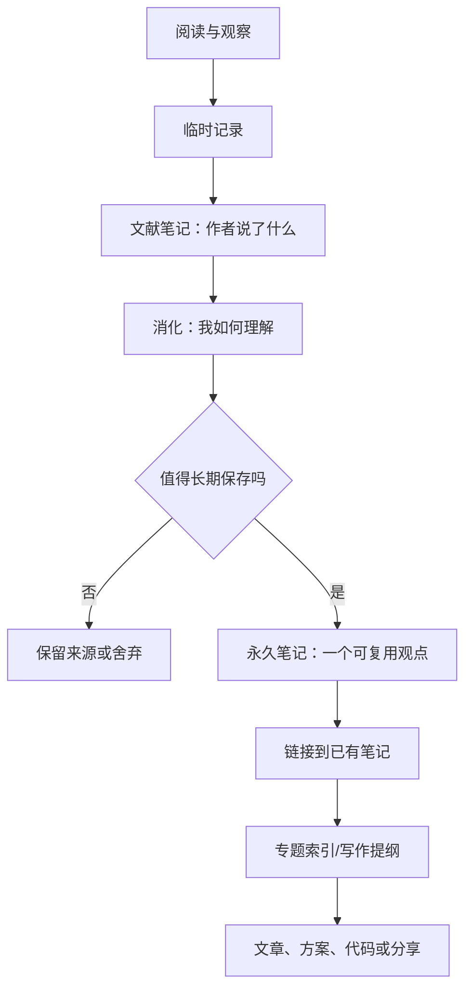

# 卡片笔记法：让笔记之间产生思想

- 视频参考：{{video https://www.youtube.com/watch?v=J2bSlD1YlTM&ab_channel=%E4%B8%8B%E4%B8%80%E6%9C%AC%E8%AE%80%E4%BB%80%E9%BA%BC%3F}}

卡片笔记的重点不是把资料切成很多小块，而是把自己的理解写成可以独立阅读、以后能再次使用的思想单元，并通过链接形成推理网络。

## 一张好卡片的结构

1. **标题是一个明确的判断或问题**，避免只有“读书笔记”“心理学”等宽泛名称。
2. **正文只表达一个主要观点**，用自己的语言解释，而不是复制大段原文。
3. **给出理由或证据**：来自书籍、研究、项目经验，还是待验证的个人假设？
4. **说明边界**：在哪些情况下成立？有没有反例？
5. **建立链接**：它回答了哪个问题，又引出哪些新问题？

## 从阅读到永久笔记

## 示例卡片

**标题：为什么检索成本会影响知识是否真正可用？**

知识即使被保存，如果未来无法在正确的情境中找到，就很难进入决策过程。因此，知识库不仅需要保存内容，还需要清晰标题、语义链接、专题索引和可复现的上下文。该观点适用于长期积累的技术知识；对于低价值、一次性信息，维护成本可能高于保存收益。

**链接建议：** [[知识管理]]、[[打造第二大脑]]、[[阅读管理]]。

## 卡片之间的关系

- 支持：另一张卡片提供证据或推导。
- 补充：解释适用条件、机制或例子。
- 对比：呈现相反观点或不同方案。
- 应用：把抽象原则用于真实项目。
- 质疑：记录反例、证据不足或待验证问题。

## 每周维护

- 检查新卡片是否有明确标题和来源。
- 为孤立卡片补充至少一个有意义的关系，或说明暂时没有关系。
- 把重复内容合并为更清楚的表达，保留不同观点的差异。
- 从卡片中挑选一个问题，写成文章、图解、程序或分享。
