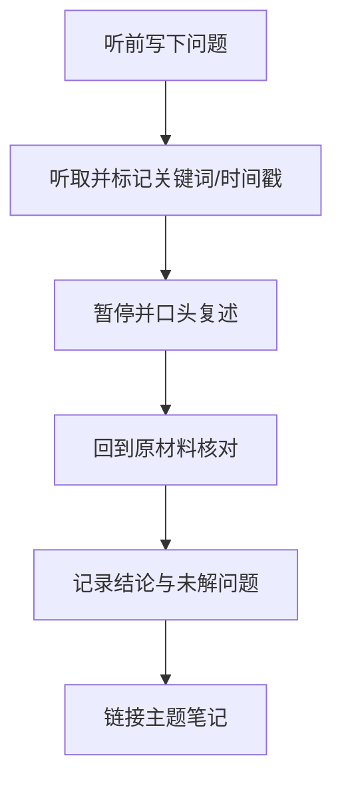

# 听觉学习：通过听与说加工信息

听觉学习包括讲座、播客、访谈、口头复述、讨论和教学。听觉材料适合获取背景与理解专家解释，但被动播放并不保证掌握。

## 主动听取的流程

## 适用场景

- 访谈、讨论和概念讲解。
- 语言听力与发音练习。
- 将复杂主题用自己的话讲清楚。
- 利用通勤或重复劳动时段获取背景信息。

## 限制与补救

- 公式、代码和精确步骤通常需要配合文字、图表或动手操作。
- 听后容易产生“听懂了”的熟悉感，应通过复述、练习和测试验证。
- 重要事实应回查原始来源，避免只凭记忆引用。
- 对长音频先确定目标问题，只记录关键观点和时间戳，之后再整理。