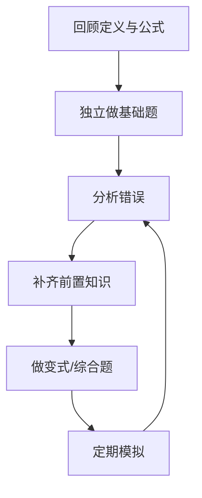

# 在职研究生学习计划入口

- [[高等数学]]
- [[线性代数]]
- [[学习管理]]
- [[考试管理]]

## 学习规划建议

- 先确认目标专业、考试科目、招生要求和当年官方时间安排。
- 把基础课分为概念理解、典型题型、综合练习和模拟测验。
- 每周安排固定学习时段，优先解决薄弱基础。
- 为错题记录错误类型、正确推导、复习日期和变式题。
- 在工作与学习之间安排合理缓冲，避免只依赖考前突击。

## 周计划模板

| 项目 | 计划内容 |
|---|---|
| 本周目标 | 需要完成的章节或题型 |
| 固定学习时段 | 工作日/周末的可用时间 |
| 练习任务 | 题量、项目或阶段测验 |
| 薄弱点 | 本周最需要解决的两个问题 |
| 复盘证据 | 正确率、独立推导、错题重做 |
| 下周调整 | 保留、增加或减少的内容 |

## 数学复习闭环

考试政策、专业目录和时间节点可能变化，应以招生单位和官方发布为准。