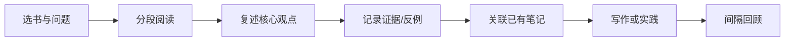

- 书籍来源参考
  https://book.douban.com/
- 书籍列表
  |编号|封面|书名|分类|阅读状态|
  |--|--|--|--|--|
  |1|||||
	-

## 如何建立可复用的书单

书籍来源可从 [豆瓣读书](https://book.douban.com/) 等平台发现，但评分和推荐只用于筛选，不代替内容质量判断。选择书籍时优先考虑当前问题、作者专业背景、证据质量、出版时间和可实践程度。

## 推荐书目记录模板

| 字段 | 记录方式 |
|---|---|
| 书名/作者 | 使用正式书名与作者姓名 |
| 主题 | 技术、文学、心理、历史、管理等 |
| 阅读状态 | 待读、在读、已读、暂缓、重读 |
| 阅读目的 | 读完希望解决什么问题 |
| 核心观点 | 用自己的话概括，不仅记录目录 |
| 相关卡片 | 链接到 [[卡片笔记]] 或对应专题 |
| 输出成果 | 文章、项目、讨论或实践 |

## 从读完一本书到真正掌握

不要以读完数量作为唯一指标。一本书若改变了一个判断、帮助解决一个问题或形成一个可复用的解释，就已经产生了实际价值。
