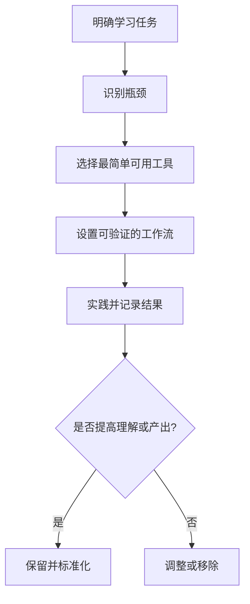

# 学习工具：服务于学习闭环

- [[数字化工具]]：笔记、阅读、检索、复习和协作软件。
- [[传统工具]]：纸笔、卡片、白板和实体书。
- [[辅助工具]]：计时、录音、截图、图表和自动化工具。
- [[卡片笔记]]：将理解沉淀为可检索的知识单元。
- [[知识管理]]：管理输入、组织、连接和输出。

## 选择工具的流程

## 选择标准

- 能否减少重复劳动或提高反馈质量？
- 数据是否容易导出、备份和迁移？
- 是否支持主动回忆、练习和复盘，而不只是收集？
- 是否能在电脑与手机之间稳定使用？
- 维护成本是否与带来的价值相称？

工具不是学习成果。学习成果应表现为能够解释、完成任务、解决问题或创造作品。
