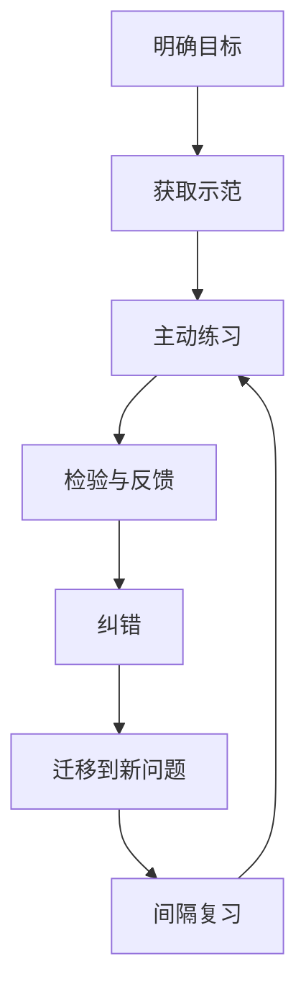

# 学习方法：选择适合任务的练习方式

学习方法应根据目标能力选择，而不是追求一种适用于所有内容的技巧。

- [[视觉学习]]：用图示、流程图、空间结构帮助理解关系。
- [[听觉学习]]：通过讲解、讨论和口头复述加工信息。
- [[实践学习]]：通过实验、练习、项目和反馈检验理解。
- [[打造第二大脑]]：把外部资料转化为可检索、可连接的知识。

## 任务与方法匹配

| 学习目标 | 优先方法 | 如何验证 |
|---|---|---|
| 记忆事实/术语 | 主动回忆、间隔复习 | 不看资料准确回忆并解释 |
| 理解机制 | 自我解释、因果图、对比例子 | 能解释为什么，并指出边界 |
| 掌握技能 | 刻意练习、即时反馈 | 在新情境中独立完成任务 |
| 学会排错 | 案例分析、故障注入、复盘 | 能定位新故障并给出证据 |
| 建立体系 | 概念图、卡片链接、专题索引 | 能从多个概念推导出完整解释 |
| 提升表达 | 写作、演讲、教学 | 他人能理解并复述核心观点 |

## 学习闭环

## 避免低效学习

- 只反复阅读，不主动回忆。
- 只看示例，不独立完成练习。
- 只追求学习时长，不定义成果。
- 只记正确答案，不分析错误原因。
- 把“熟悉感”误当成能独立应用的能力。

每次学习结束前，写下一个能证明自己学会了的动作，例如解释、推导、编写、测试或讲给别人听。
