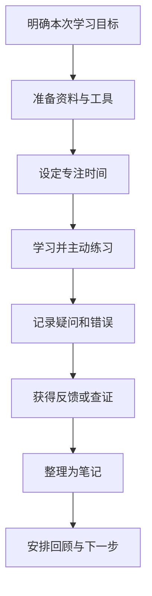

# 学习环境

> 学习环境不仅是教室或软件，也包括时间安排、注意力、工具、反馈渠道、同伴关系和实践条件。好的环境应降低开始学习的摩擦，并让学习结果能够被检验。

## 1. 学习环境的组成

| 组成 | 需要考虑的问题 | 可采取的行动 |
|---|---|---|
| 物理环境 | 光线、噪声、座位和设备是否合适？ | 准备固定学习位置，减少干扰 |
| 数字环境 | 文件、链接、工具和通知是否分散注意力？ | 统一入口，关闭无关通知 |
| 时间环境 | 是否有连续的专注时间？ | 将任务拆成可完成的小块 |
| 社会环境 | 是否能得到提问、讨论和反馈？ | 找到学习伙伴或专业社区 |
| 实践环境 | 是否能动手实验并观察结果？ | 准备沙盒、练习题或小项目 |
| 复盘环境 | 是否能看到进步和薄弱点？ | 保存练习结果、错题和复盘记录 |

## 2. 不同学习场景

- [[传统课堂]]：适合结构化讲授、即时答疑和与同伴互动。
- [[在线学习]]：适合灵活安排时间、使用多媒体资源和重复观看。
- [[实地考察]]：适合接触真实设备、工作流程和复杂情境。

这三种方式可以组合使用。理解原理后，尽量通过练习、观察或项目把知识与现实问题连接起来。

## 3. 设计一个可持续的学习工作区

## 4. 环境检查清单

- [ ] 本次学习目标具体到可以检查的结果。
- [ ] 需要的资料、代码、设备或练习已准备好。
- [ ] 已关闭无关通知，安排了不被打断的时间。
- [ ] 有练习或输出，而不是只被动阅读。
- [ ] 记录了未解决的问题和错误原因。
- [ ] 结束时写下下一步行动。

## 5. 相关笔记

- [[学习管理]]
- [[学习策略]]
- [[学习工具]]
- [[数字化工具]]
- [[传统工具]]
- [[实践学习]]