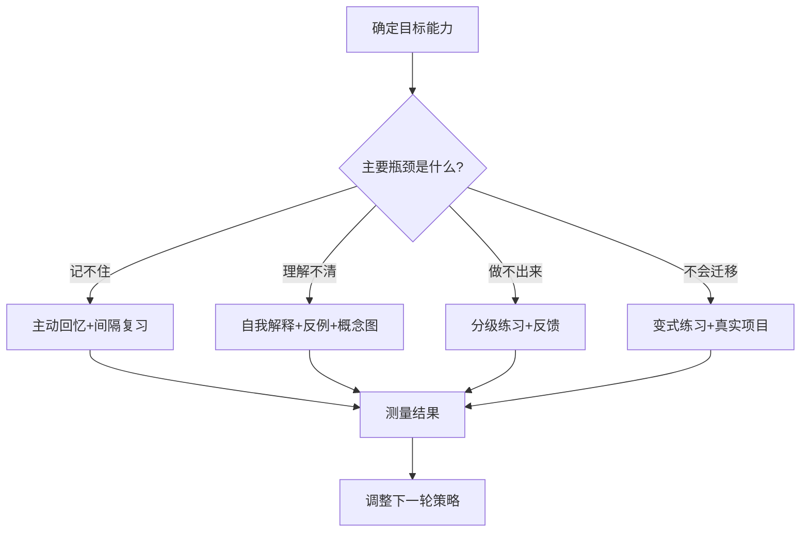

# 学习策略：规划、复习与迁移

学习策略用于决定学什么、何时学、如何练习以及怎样判断进步。

- [[时间管理]]：为高价值学习安排稳定时间块。
- [[记忆技巧]]：利用主动回忆、间隔复习和精细加工。
- [[理解方法]]：通过解释、比较、推导和例子建立概念模型。
- [[学习管理]]：把目标转为任务、练习和复盘。
- [[卡片笔记]]：将可复用的观点沉淀为知识单元。

## 策略选择流程

## 每周学习计划模板

- 本周一个主要能力目标：
- 完成标准（可观察、可测试）：
- 必须学习的概念：
- 练习或项目：
- 预计投入时间：
- 反馈来源：
- 复习安排：
- 本周末的验收方式：

## 复盘指标

优先观察正确率、独立完成度、解决问题所需时间、错误类型和知识迁移情况。学习时长可以帮助安排资源，但不能单独证明掌握程度。
