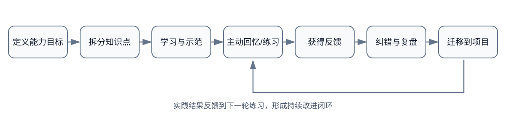
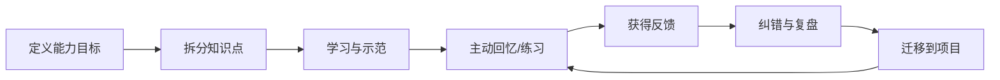

# 学习管理：用反馈形成能力

学习记录入口：卡片笔记写作法则

- [[软件学习]]
- [[学习方法]]
- [[学习环境]]
- [[学习工具]]
- [[学习策略]]
- [[编程语言]]
- [[CS自学指南]]
- [[卡片笔记]]

## 学习循环

若当前阅读器未能渲染 Mermaid，可先查看下方 SVG 图示；Mermaid 源码保留用于支持原生渲染的客户端。

## 把目标写成可验证结果

不要只写“学习 C 语言”，而要写“能够解释指针与数组的差异，并实现带边界检查的字符串处理函数，使用测试覆盖空输入、长度上限和非法参数”。

一个学习任务应包含：
- 目标能力与完成标准
- 所需前置知识
- 资料与练习
- 可展示的成果
- 反馈来源
- 复习或再次实践的时间

## 复盘问题

1. 哪个概念仍然只能背诵、无法解释？
2. 哪种错误重复出现？它来自知识缺口还是练习方式？
3. 能否不看资料讲清楚，并完成一个新例子？
4. 哪个知识点已在真实项目中使用？
5. 下一次练习应该提高难度、增加反馈，还是回到前置知识？
