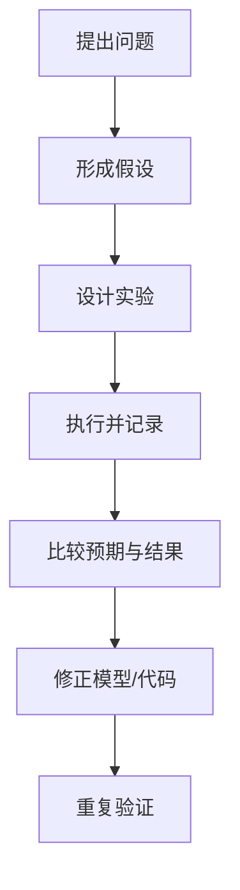

# 实践学习：用可观察结果检验理解

- 实验
- 模拟
- 项目实现与故障排查

实践学习把概念转化为可执行的操作，并通过观察结果修正理解。有效实践必须有问题、预期结果、可控变量和复盘。

## 实验记录模板

- **问题**：想验证什么？
- **假设**：预期发生什么，依据是什么？
- **环境**：硬件、软件、版本、配置和工具。
- **步骤**：如何重复执行？
- **输入与变量**：哪些条件保持不变，哪些条件改变？
- **结果**：日志、测量值、截图或测试输出。
- **结论**：证据支持或否定了什么？
- **后续**：仍有哪些限制，下一步做什么？

## 实践闭环

不要只记录成功路径。失败现象、错误日志和反例往往更有助于形成工程能力。
