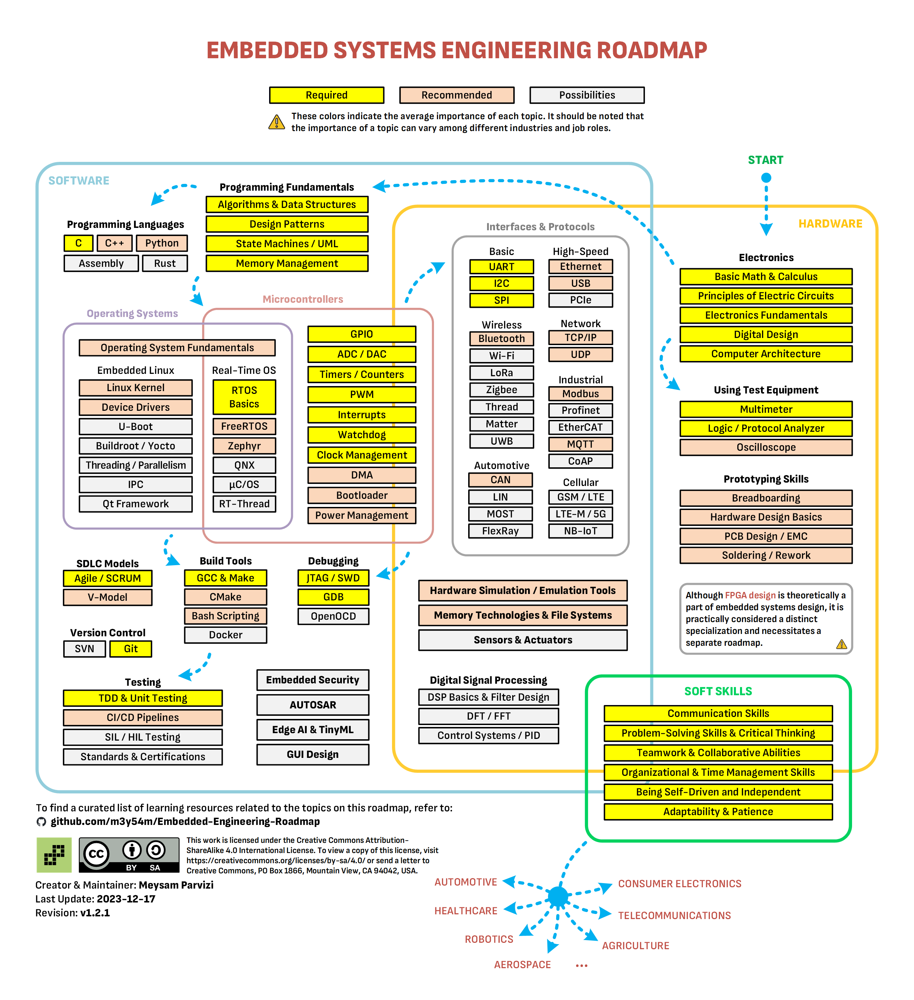
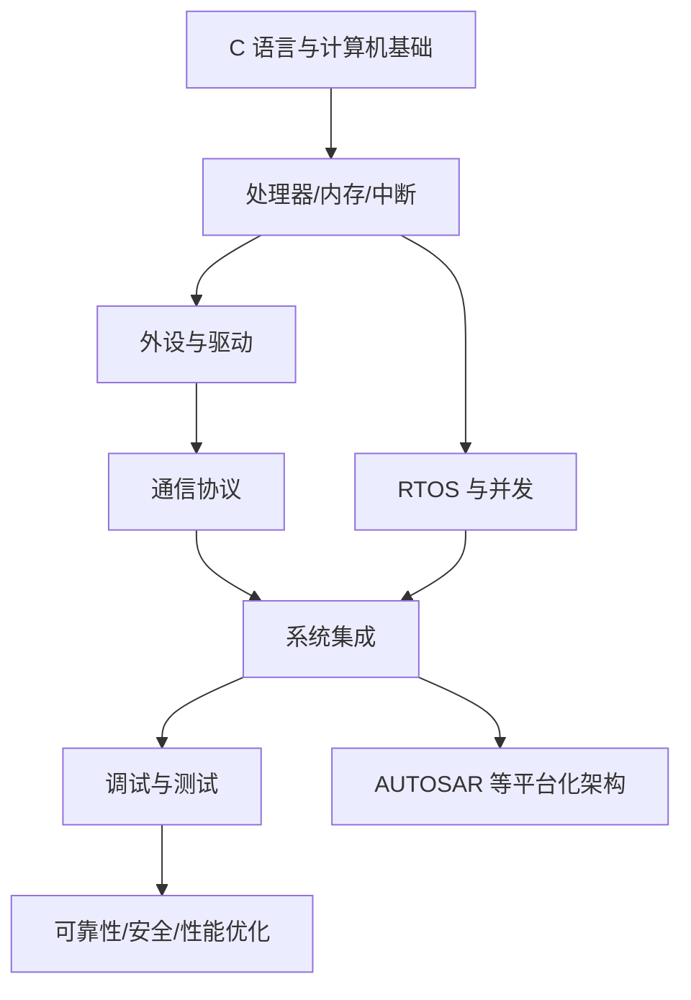

# 嵌入式工程学习总图

{:height 729, :width 659}

参考路线：https://github.com/m3y54m/Embedded-Engineering-Roadmap

嵌入式开发不是单纯编写 C 代码，而是软件、处理器、存储器、外设、电路、实时约束和调试工具的协同工程。

- [[嵌入式系统]]：硬件与软件协作、启动过程、实时约束
- [[嵌入式软件]]：C、驱动、RTOS、通信协议、测试
- [[嵌入式硬件]]：电源、时钟、复位、总线、接口与测量
- [[C语言]]：指针、内存、类型、编译与链接
- [[汇编语言]]、[[Registers]]、[[Interrupts]]：处理器底层
- [[AUTOSAR]]：汽车 ECU 软件平台
- [[Tools]]：编译器、调试器、逻辑分析仪、示波器和静态分析工具

## 能力依赖图

## 从入门到工程实践

| 阶段 | 学习任务 | 最小实践 |
|---|---|---|
| 入门 | 二进制、C、编译/链接、Git | 编写并测试独立 C 程序 |
| 外设 | GPIO、定时器、UART、SPI、I²C、ADC | 读取传感器并输出测量值 |
| 中断 | 中断入口、优先级、共享数据 | 测量中断响应并验证竞态 |
| 实时系统 | 任务、调度、同步、超时、看门狗 | 将周期任务拆分并测量抖动 |
| 通信 | CAN、LIN、Ethernet、诊断协议 | 分析一条消息的发送与接收链路 |
| 集成 | 配置、接口、构建、自动测试 | 建立可复现的构建和回归测试 |
| 进阶 | 性能、故障注入、功能安全、代码质量 | 对异常路径、边界值和资源耗尽做测试 |

## 每次实验都要留下的证据

- 目标与假设：这次实验要验证什么？
- 环境：板卡、芯片、工具链、版本、时钟和编译选项。
- 输入：寄存器值、总线报文、传感器输入或测试数据。
- 观测：串口日志、波形、寄存器快照、测量时间。
- 结论：哪些假设被支持，哪些被否定？
- 回归：如何把问题转成可重复执行的测试？

## 排查原则

先验证供电、时钟、复位和连接，再验证启动、内存和外设配置；之后沿软件调用链定位，最后才进行大范围重构。每次只改变一个主要变量，保存修改前后的日志和测量结果。
