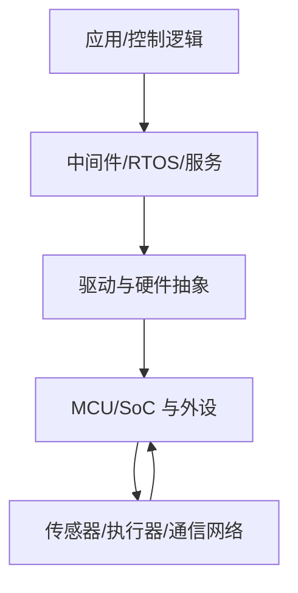

# 嵌入式系统

嵌入式系统是为特定功能设计的计算系统，通常与传感器、执行器或其他设备紧密结合。它的设计重点不仅是功能正确，还包括实时性、可靠性、资源约束、功耗、可维护性和安全性。

## 主要特点

- **实时性**：结果需要在规定时间内产生；正确但太晚的结果可能仍然无效。
- **资源约束**：CPU、RAM、Flash、带宽和能耗可能有限。
- **可靠性**：需要处理电源波动、通信故障、异常输入和长期运行。
- **软硬件协同**：程序行为受到芯片、外设、电路和时钟配置影响。
- **可维护性**：需要可追踪的构建、调试、升级和回归验证。

## 系统组成

## 典型应用

- [[汽车电子]]：车身控制、动力底盘、网关和域控制器。
- 工业控制：电机控制、过程监测、设备联网。
- 医疗设备：采集、控制和安全相关功能。
- 智能家居与 IoT：传感、联网和低功耗运行。

## 学习路径

从 C 语言与计算机基础开始，理解处理器和内存，再完成 GPIO、定时器、UART、SPI/I²C、ADC 等驱动实验；之后学习中断、RTOS、通信协议、测试和系统集成。每个阶段都应有可运行的实验与记录。
