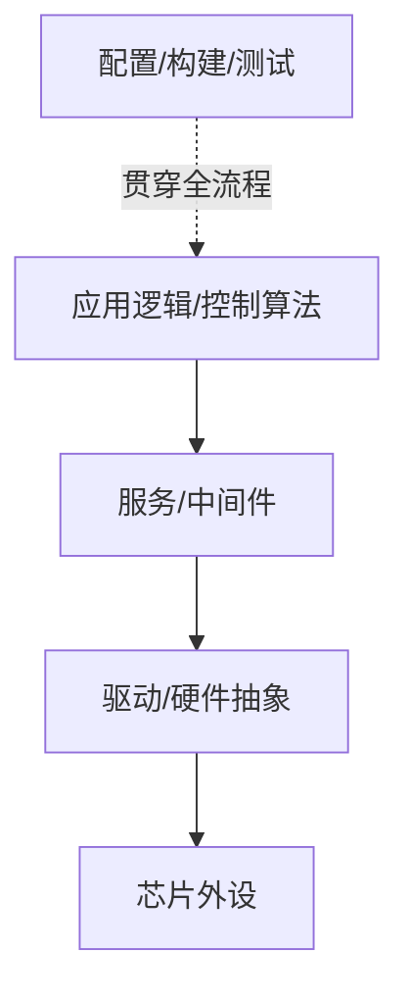

# 嵌入式软件

嵌入式软件控制硬件资源，并实现采集、通信、控制、诊断和系统管理等功能。它必须考虑硬件限制、实时行为、故障恢复和可验证性。

- [[C语言]]：常见底层开发语言。
- [[OS(Operating System)]]：任务调度、同步与时间服务。
- [[Interrupts]]：外设事件与中断处理。
- [[Communication]]：通信协议与报文链路。
- [[Development Process]]：从需求到测试的工程流程。
- [[Tools]]：编译、调试、测量与验证工具。

## 软件层次示意

## 核心质量属性

- 实时性：周期、截止时间、响应时间和抖动。
- 可靠性：异常输入、资源不足、通信中断时的行为。
- 可移植性：硬件相关代码与业务逻辑的边界。
- 可测试性：模块接口、模拟环境、日志和自动化回归。
- 可维护性：清晰命名、接口契约、版本追踪和文档。
- 安全性：根据系统风险实施必要的保护、监测和验证。

## 开发建议

1. 先定义需求与验收条件。
2. 设计模块边界、数据流和错误处理。
3. 为关键逻辑建立单元测试或可执行实验。
4. 通过静态分析、编译告警和代码审查降低缺陷。
5. 使用调试器、日志和硬件测量验证实际运行行为。
6. 将已发现的缺陷转为回归测试。
