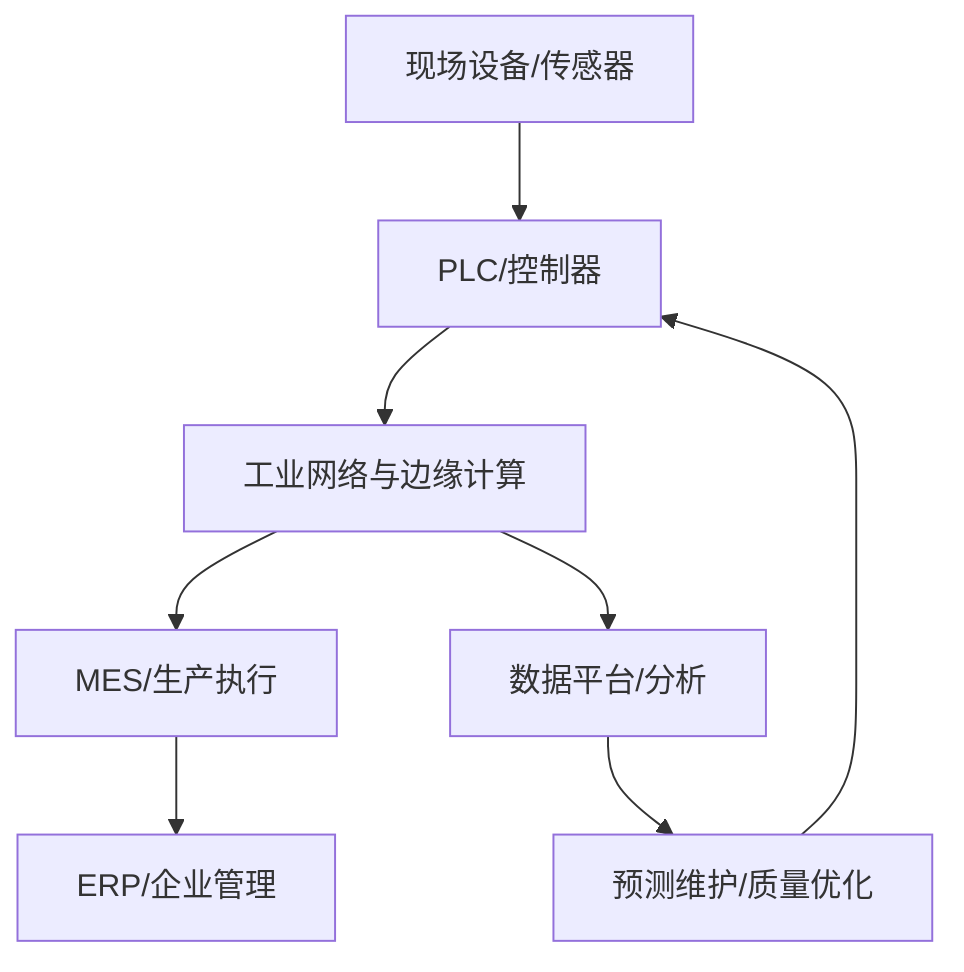

- 工业4.0（Industry 4.0）是基于工业发展的不同阶段作出的划分。按照共识，工业1.0是[[蒸汽机时代]]，工业2.0是[[电气化时代]]，工业3.0是[[信息化时代]]，工业4.0则是利用信息化技术促进产业变革的时代，也就是智能化时代。
  :LOGBOOK:
  CLOCK: [2024-02-25 Sun 20:25:14]--[2024-02-25 Sun 20:25:15] =>  00:00:01
  CLOCK: [2024-02-25 Sun 20:25:16]--[2024-02-25 Sun 20:25:17] =>  00:00:01
  :END:
  
  工业4.0的概念最早出现在`德国`，2013年的汉诺威工业博览会上正式推出，其核心目的是为了提高德国工业的竞争力，在新一轮[[工业革命]]中占领先机。随后由德国政府列入《德国2020高技术战略》中所提出的十大未来项目之一。该项目由德国联邦教育局及研究部和联邦经济技术部联合资助，投资预计达2亿欧元。旨在提升制造业的[[智能化]]水平，建立具有适应性、资源效率及基因[工程学]的[[智慧工厂]]，在商业流程及价值流程中整合客户及商业伙伴。其技术基础是网络实体系统及[[物联网]]。

## 工业4.0的系统视角

工业4.0并非单一设备或软件，而是把生产设备、传感器、控制系统、企业系统和供应链连接起来，利用数据提升可视化、协同和优化能力。实际系统需要同时考虑互操作性、网络安全、实时性、可靠性和人员流程。

## 关键技术与问题

- **工业物联网**：设备标识、数据采集、协议互通与设备管理。
- **数字孪生**：让物理对象与数字模型保持可验证的关联，明确模型边界和数据更新频率。
- **智能制造**：以数据和模型优化质量、产能、能耗与设备维护。
- **边缘与云协同**：根据时延、带宽、隐私和可靠性要求分配计算任务。
- **网络安全**：资产盘点、分区分域、访问控制、更新管理和事件响应。

评估一个工业4.0案例时，应先定义业务指标，再检查数据质量、系统接口、异常处理、人员流程和投资回报，避免把技术堆叠误当作数字化转型。
