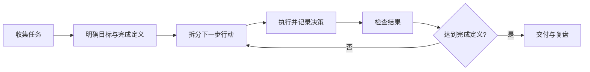

# 工作管理：让任务与知识共同推进

原有工作相关入口：
- [[电子电气架构]]
  card-last-score:: 1
  card-repeats:: 1
  card-next-schedule:: 2024-02-25T16:00:00.000Z
  card-last-interval:: -1
  card-ease-factor:: 2.5
  card-last-reviewed:: 2024-02-25T02:04:38.286Z
- [[工具软件]]
- [[软件架构]]
- [[汽车电子]]
- [[嵌入式]]

## 工作任务的最小描述

每项重要任务至少应包含：
- **目标**：要解决什么问题，为什么现在做？
- **完成定义**：什么证据能够证明已完成？
- **下一步行动**：可以立即执行的最小动作。
- **约束与依赖**：时间、资源、接口、外部审批或技术限制。
- **风险与阻塞**：可能失败的原因、预警信号和备选方案。
- **相关知识**：关联专题页、决策记录、代码和测试证据。

## 工作闭环

## 每日与每周管理

- 每天开始时，选择一到三个真正重要的结果。
- 对未完成任务写清下一步动作，而不是只保留模糊标题。
- 任务被阻塞时，记录等待谁/什么、何时跟进以及替代方案。
- 每周清理已完成、失效和优先级变化的任务。
- 项目结束后沉淀决策、经验、可复用模板和回归检查项。

管理的重点不是把每一分钟排满，而是让关键工作持续推进，并且能解释结果与决策依据。
