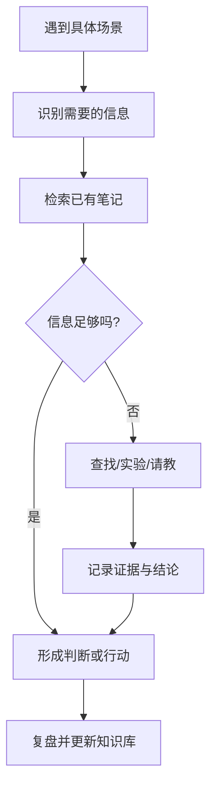

# 知识管理的应用场景

知识系统应围绕实际使用场景设计，而不是先建立复杂分类再寻找用途。

- **学习**：组织课程、练习、错题、卡片和阶段复盘。
- **工作**：保存决策、流程、会议结论、问题解决和复用模板。
- **项目管理**：追踪目标、范围、风险、行动和交付证据。
- **创意思维**：记录观察、类比、问题和不同领域之间的连接。
- **日常记录**：保存事件、计划和待处理事项。

## 场景驱动的知识流

每种场景都应有明确的成功标准，例如学习场景关注能否独立完成任务，项目场景关注交付是否满足验收条件，创意场景关注能否形成新方案或可检验假设。
