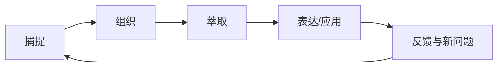

# 打造第二大脑：捕捉、组织、萃取、表达

第二大脑是一个外部知识系统，用于降低记忆负担，让有价值的信息在需要时被找到并转化为行动或作品。它不是无限收藏夹，也不能替代理解和判断。

## CODE 工作流

- **C — Capture（捕捉）**：保存有价值的想法、问题、摘录和观察。
- **O — Organize（组织）**：使用 [[PARA]] 按项目、领域、资源和归档安排资料。
- **D — Distill（萃取）**：用自己的话提炼关键观点，标记重点并补充上下文。
- **E — Express（表达）**：通过写作、方案、代码、分享或决策来使用知识。

## 一个可持续的最小系统

1. 一个快速收集入口：先记下问题与来源，不中断当前工作。
2. 一个项目/领域索引：让活跃内容容易找到。
3. 一组主题笔记：保存经过理解、可以独立复用的观点。
4. 一套来源记录：区分原文、作者观点、个人解释和待验证假设。
5. 一个输出机制：每周从笔记中完成一个可见成果。

## 什么值得捕捉？

优先保存能改变决策、解释复杂问题、形成新连接、帮助未来重复任务或支持长期目标的信息。一次性信息可以只保存链接或直接舍弃。

## 检查是否真正有效

- 是否能在几分钟内找到关键资料？
- 是否能用自己的话解释，而不依赖原文？
- 是否能把旧笔记连接到当前问题？
- 是否有输出、决策或项目成果证明这些知识被使用？
- 维护系统的成本是否低于它带来的收益？

相关主题：[[PARA]]、[[知识管理]]、[[卡片笔记]]、[[笔记管理]]、[[阅读管理]]。
