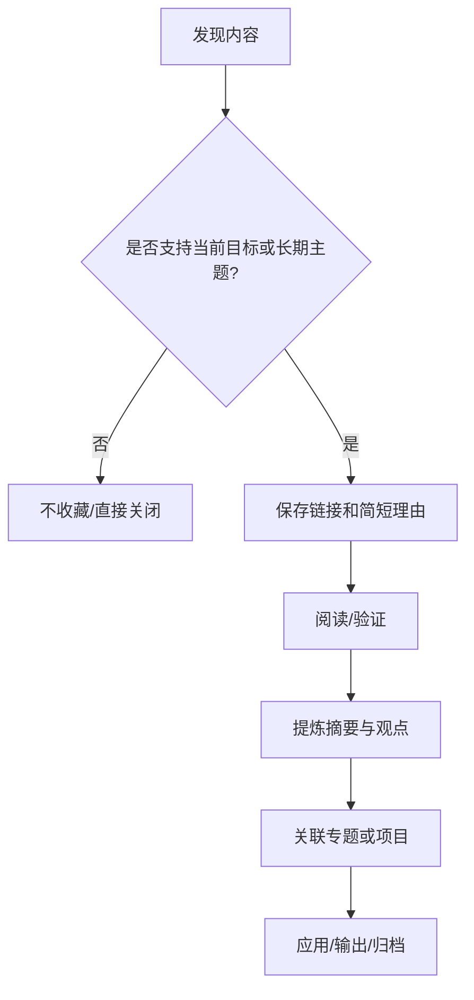

# 收藏管理：从保存链接到可检索资源

- [[笔记软件]]
- [[常用链接]]
- [[博客收集]]
- [[工具管理]]
- [[阅读管理]]

收藏是信息输入的入口，不是学习成果。为了让收藏未来可用，重要资源应保留标题、作者/机构、来源链接、主题、保存原因和处理状态。

## 收藏流程

## 维护规则

- 重要收藏要有明确标题，避免只保存裸链接。
- 对技术结论优先追溯官方文档、标准或可复现案例。
- 为需要进一步阅读的资源标注状态和下一步动作。
- 定期去重、检查失效链接并归档不再需要的内容。
- 不要把收藏数量当作知识积累的衡量标准。
