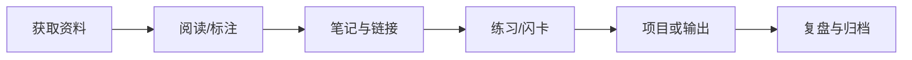

# 数字化学习工具

数字化工具适合检索、跨设备同步、长期保存、协作和自动化。工具链应服务学习任务，而不是让记录与维护本身成为额外负担。

## 常见工具类别

- 阅读与文献：电子书、PDF 阅读器、文献管理工具。
- 笔记与检索：Logseq、Markdown 编辑器、全文搜索。
- 记忆与复习：闪卡、间隔复习、主动回忆工具。
- 练习与实验：编译器、模拟器、在线练习环境、数据分析工具。
- 协作与发布：Git、代码托管、文档发布和任务管理。

## 工具链示意

## 选择标准

- 数据能否导出为开放格式？迁移后链接和附件是否完整？
- 是否支持离线使用、全文搜索和可靠备份？
- 是否有明确的主存储位置，避免同一内容在多处出现冲突版本？
- 隐私、共享权限和账号恢复机制是否满足需求？
- 订阅费用、插件维护和学习成本是否与实际收益相称？

## 最小实践

先选一个真实学习主题，用工具链完成“资料—笔记—练习—输出”的闭环；记录每一步的摩擦点，再决定是否增加新工具。