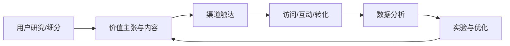

- 所谓数字营销，就是指借助于互联网络、电脑[[通信技术]]和数字交互式媒体来实现[[营销目标]]的一种营销方式。数字营销将尽可能地利用先进的计算机网络技术，以最有效、最省钱地谋求新的市场的开拓和新的消费者的挖掘。数字营销是基于明确的[[数据库对象]]，通过数字化多媒体渠道，比如电话、短信、邮件、[[电子传真]]、[[网络平台]]等数字化媒体通道，实现营销精准化，[[营销效果]]可量化，数据化的一种高层次营销活动。
- 数字营销之前曾被看作是特殊领域的独立营销形式，但是，由于它提供了相同的受众沟通方式（只不过是以数字形式而已），2003年开始已经经常被看作是能够涉及到绝大多数的传统营销领域（如[[直复营销]]的营销形式。
- 在[[数字经济]]时代，传统企业实现数字化时，必须把数字营销作为一个重要的方面来关注，变革原本不能满足需要的[[营销思想]]、模式和策略，实现新的营销方式。与数字管理、[[生产制造]]一道，数字营销作为一个热点，将成为[[数字企业]]的三个重要组成部分之一。一般来说，在[[充分竞争]]的市场上企业只能得到[[正常利润]]，如果想得到[[超额利润]]，那就必须创新。创新是对[生产要素]进行新的组合，从[[经济学]]的意义上讲，它不仅包括技术创新，也包括了[[营销创新]]。其中，数字营销就是创新的典型事物。
- 数字营销不仅仅是一种技术手段的革命，而且包含了更深层的观念革命。它是[[目标营销]]、[[直接营销]]、分散营销、[[客户导向]]营销、双向[[互动营销]]、远程或全球营销、[[虚拟营销]]、[[无纸化交易]]、客户参与式营销的综合。 [3]数字营销赋予了营销组合以新的内涵，其功能主要有[[信息交换]]、网上购买、网上出版、[[电子货币]]、网上广告、企业公关等，是数字经济时代企业的主要营销方式和[[发展趋势]]。

## 数字化营销的闭环模型

数字化营销通过数字渠道与数据反馈支持受众触达、需求理解、转化和客户关系维护。有效的营销不只是增加曝光，还需要明确目标人群、价值主张、渠道成本、转化路径和长期信任。

## 指标分层

- **触达**：覆盖人数、展示量、有效到达率。
- **互动**：点击率、阅读深度、停留时间、收藏或分享。
- **转化**：线索、注册、购买、留存及转化成本。
- **长期价值**：复购、客户生命周期价值、满意度与推荐意愿。
- **风险指标**：退订、投诉、无效流量、隐私违规和品牌负面反馈。

## 实施原则

1. 从业务目标倒推指标，避免只追求虚荣指标。
2. 明确数据来源、口径、采样偏差和归因窗口。
3. 通过小规模实验比较方案，不把相关性直接解释为因果关系。
4. 遵守隐私、同意、数据最小化和平台规则。
5. 将实验结果沉淀为可复用知识，并记录未成功的假设。
