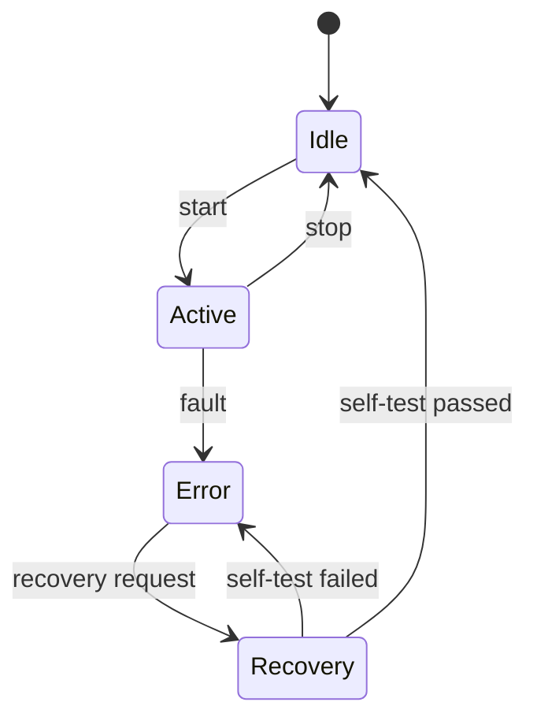

# 数学与工程应用

> 本页把数学概念与嵌入式、汽车电子和软件工程中的真实问题建立映射。它是专题导航与解释页；完整原始问题和笔记保存在 Flomo Archive 中。

## 1. 数学知识如何进入工程

| 数学主题 | 核心对象 | 工程落点 | 相关笔记 |
|---|---|---|---|
| 线性代数 | 向量、矩阵、线性变换、特征值 | 坐标变换、信号解码、状态空间、控制算法 | [矩阵变换原始卡](Flomo%20Archive/MjQ5MDI4Mjc5.md)、[线性代数问题库](Flomo%20Archive/MjQ1NzMyNDU5.md) |
| 概率论与统计 | 随机变量、条件概率、估计与检验 | 故障诊断、误报漏报分析、可靠性评估 | [概率论问题库](Flomo%20Archive/MjQ3MzMwNjE5.md) |
| 马尔可夫链 | 状态、转移矩阵、平稳分布 | BswM 状态机建模、网络管理、流程状态分析 | [马尔可夫链专题](Flomo%20Archive/MjQ3MzMwNjkw.md) |
| 微积分 | 极限、导数、积分、微分方程 | ADC 采样、离散控制、变化率与累积量分析 | [高等数学](高等数学.md) |

## 2. 矩阵变换：从物理量到软件语义

矩阵和线性变换可以理解为“在明确的坐标系之间转换表示”。这在工程里并非抽象比喻，而是可被公式、配置和测试验证的变换关系。

- **FOC / Park 变换**：把三相静止坐标系中的电流表示转换到旋转的 d-q 坐标系。实际公式与符号约定应以控制算法和相序定义为准。
- **DBC 解码**：把 CAN 帧中的起始位、长度、字节序、符号位、因子和偏移映射为物理量。DBC 解码通常是位域提取加仿射变换，不应笼统称为“矩阵乘法”。
- **AUTOSAR RTE**：负责 SWC 间以及 SWC 与基础软件/通信栈之间的数据访问与连接。RTE 不是数学坐标变换本身，但它承担了接口映射、数据传递和生成代码落地。

## 3. 概率论：从观测证据到诊断判断

诊断问题通常不是简单的“有故障/无故障”，而是依据观测证据更新对不同故障原因的置信程度。

贝叶斯公式：

\[P(H\mid E)=\frac{P(E\mid H)P(H)}{P(E)}\]

其中 H 是候选故障假设，E 是测量或诊断证据。应用时要注意：先验概率、证据条件概率和样本代表性都需要数据支撑；一次偶发 DTC 不能直接等同于部件失效。

可进一步关联 [诊断栈](Diagnostic%20Stack.md)、[汽车电子](汽车电子.md) 和 [嵌入式硬件](嵌入式硬件.md)。

## 4. 马尔可夫链：状态转移与长期行为

离散时间马尔可夫链满足：下一时刻状态在给定当前状态后，与更早历史条件独立。若采用行随机矩阵约定，转移矩阵每行之和为 1；若采用列向量约定，需相应调整乘法方向。

工程应用时，状态转移概率必须来自明确的统计口径或模型假设。AUTOSAR BswM 等规则驱动状态管理不天然等价于随机马尔可夫链；只有在分析随机转移或长期占比时才适合引入概率模型。

## 5. 微积分与离散系统

ADC 将连续时间信号转为离散采样序列。采样周期、抗混叠滤波、量化误差和采样保持都会影响结果；不能仅凭“采样足够快”就断言连续信号被无损恢复。控制算法中的离散积分、差分和滤波，也需要明确采样周期与数值精度。

## 6. 推荐学习顺序

1. 先完成 [高等数学](高等数学.md) 的极限、导数与积分基础。
2. 学习向量、矩阵、线性变换和特征值，再读线性代数问题库。
3. 学习条件概率、随机变量、期望方差和假设检验。
4. 以马尔可夫链理解状态转移、平稳分布和 MCMC 的适用边界。
5. 回到工程案例，用公式、配置、波形或测试数据验证每个映射。

## 7. 原始来源

- [考研数学 1000 问总导航](Flomo%20Archive/MjQ2Mzc0OTc2.md)
- [线性代数 1000 问](Flomo%20Archive/MjQ1NzMyNDU5.md)
- [概率论问题库](Flomo%20Archive/MjQ3MzMwNjE5.md)
- [马尔可夫链深度专题](Flomo%20Archive/MjQ3MzMwNjkw.md)
- [矩阵变换与嵌入式工程应用](Flomo%20Archive/MjQ5MDI4Mjc5.md)

> 归档内容保留原始表述；本专题页对工程类比作了边界澄清。涉及芯片、电路、AUTOSAR 版本或控制算法的具体结论，仍须回到项目数据手册、标准、配置和实测结果核验。
