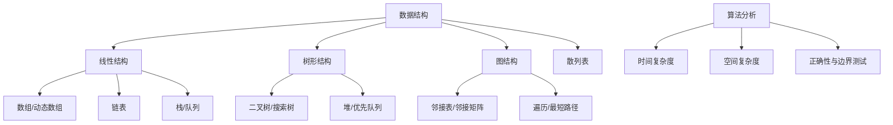

# 数据结构与算法基础

数据结构组织数据，算法定义处理步骤。选择数据结构时，应同时考虑访问模式、时间复杂度、空间开销、数据规模和错误处理。

## 知识地图

## 常见结构比较

| 结构 | 适合场景 | 需要关注 |
|---|---|---|
| 数组 | 连续存储、按下标访问 | 插入删除成本、容量 |
| 链表 | 已知节点位置时插入/删除 | 指针安全、缓存局部性 |
| 栈 | 后进先出、调用路径、解析 | 溢出、空栈访问 |
| 队列 | 先进先出、缓冲和任务排队 | 满/空、并发访问 |
| 哈希表 | 键值查找 | 冲突、负载因子、键稳定性 |
| 树/堆 | 层次关系、优先级管理 | 平衡性、堆序性质 |
| 图 | 网络、依赖、路径规划 | 环、连通性、权重与方向 |

## 复杂度如何理解

- **O(1)**：操作成本不随输入规模线性增长，例如数组按下标读取（忽略边界检查等常数开销）。
- **O(log n)**：规模每次缩小固定比例时常见，例如平衡搜索树查找。
- **O(n)**：通常需要扫描一次数据，例如线性查找。
- **O(n log n)**：许多高效比较排序算法的典型复杂度。
- **O(n²)**：双重遍历或朴素比较算法常见的增长量级。

复杂度是增长趋势的抽象，不等于某台设备上的实际耗时；缓存、分配、数据分布和常数开销也会影响性能。

## 学习每种结构的固定步骤

1. 画出内存或节点示意图。
2. 写明不变量，例如栈顶位置、队列头尾、树的排序性质。
3. 实现核心操作并分析复杂度。
4. 测试空数据、单元素、极限容量、重复值和非法输入。
5. 用随机数据或参考实现进行差分测试。
6. 记录适用场景和不适用场景，避免只背复杂度表。

推荐先从数组、链表、栈、队列和哈希表开始，再学习树、堆、图及典型算法。