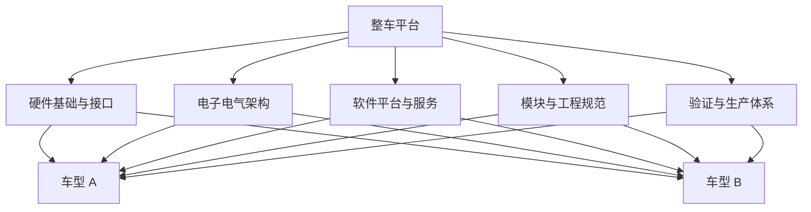

# 整车平台

> 整车平台是对一组车型共享的技术基础、架构约束、模块接口和工程规则的组织方式。它不只是底盘或发动机等硬件的简单共用，也可能涉及电气电子架构、软件平台、生产工艺和验证体系。

## 1. 平台与车型的关系

不同车型可以复用平台能力，同时通过轴距、动力形式、配置、功能和标定形成差异。实际复用范围取决于企业的平台定义与产品策略。

## 2. 平台化的收益与代价

**潜在收益**
- 减少重复开发和验证工作。
- 共享成熟模块、工具链和工程规范。
- 提高供应链与生产的一致性。
- 让软件功能更容易跨车型复用。

**潜在代价**
- 平台约束可能限制个别车型的差异化设计。
- 共用模块的缺陷可能影响多个产品。
- 兼容多个车型和版本会增加配置与测试组合。
- 过度追求共用可能引入不必要的复杂度。

## 3. 平台化与模块化

| 概念 | 关注点 |
|---|---|
| 平台化 | 多产品共享哪些基础能力与约束 |
| 模块化 | 系统如何拆分为职责明确、接口稳定的模块 |
| 标准化 | 接口、流程或验证规则如何统一 |
| 复用 | 某个模块或资产在多个项目中再次使用 |
| 变型管理 | 如何控制车型、配置、硬件和软件版本差异 |

## 4. 对汽车软件工程的影响

平台化的软件工程通常需要管理：
- ECU 与硬件变型；
- 软件组件及其依赖版本；
- ARXML、通信矩阵和诊断配置；
- 编译器、生成器、基础软件和标定版本；
- 功能变体与条件编译；
- 跨车型回归测试和缺陷影响分析。

平台复用不能替代项目级验证。每个车型和配置仍需确认接口、时序、资源占用、故障行为和法规要求。

## 5. 评估平台设计的关键问题

1. 共用部分是否稳定，差异部分是否有清晰边界？
2. 接口能否支持必要的车型变体，而不引入大量特殊分支？
3. 平台升级是否可追踪、可回滚并可进行影响分析？
4. 测试是否覆盖配置组合和共用组件的回归风险？
5. 复用带来的收益是否超过适配与维护成本？

## 6. 相关笔记

- [[汽车电子]]
- [[电子电气架构]]
- [[软件定义汽车]]
- [[AUTOSAR]]
- [[Configuration]]
- [[Development Process]]

## 7. 延伸阅读

原始资料入口：[汽车平台概念介绍（知乎专栏）](https://zhuanlan.zhihu.com/p/635744234)。该链接用于延伸阅读，具体观点应结合来源日期和其他资料交叉核对。