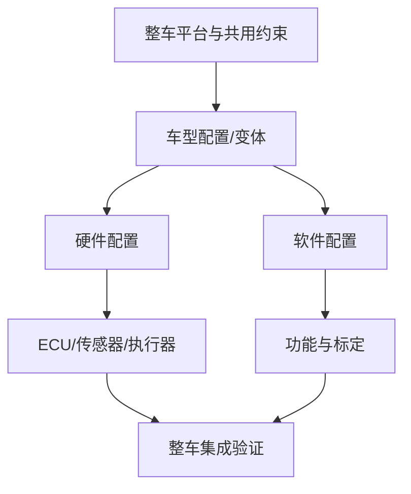

# 整车平台：共享架构与车型差异

整车平台是汽车产品开发中复用的一组基础架构、关键部件、接口和工程规范。平台化可以减少重复开发、提高零部件复用率，但不意味着不同车型的结构、性能或软件完全相同。

## 平台通常共享什么

- 车身/底盘的部分结构与接口约束。
- 动力系统、电气电子架构或关键模块的设计基线。
- 供应链、制造工艺、验证方法和部分软件资产。
- 开发流程、配置规则与合规验证要求。

具体共享范围取决于厂商的平台策略、车型定位和技术路线。

## 平台、车型与 ECU 的关系

## 从电子电气角度分析平台

1. 平台采用怎样的 E/E 架构：分布式、域集中或区域控制？
2. ECU、域控制器和网关如何分配功能？
3. CAN、LIN、Ethernet 等网络如何组合？
4. 哪些软件、诊断、标定与配置可以跨车型复用？
5. 车型差异如何通过变体配置、接口契约和测试覆盖？

参考资料：[汽车平台概念介绍](https://zhuanlan.zhihu.com/p/635744234)。外部文章适合作为入门材料；具体技术结论应进一步与厂商官方资料、项目文件和工程实践交叉核对。