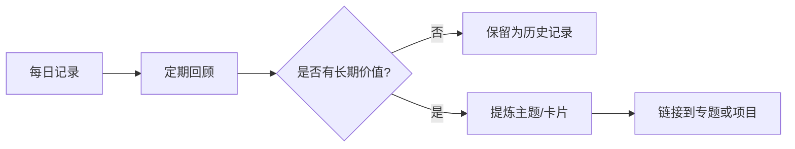

# 日记管理：记录事实、判断与行动

日记适合保存当日事件、临时想法、工作进展和未整理的问题。它的价值在于保留时间与情境，而不是要求每条记录都立刻变成正式知识。

- 示例入口：[[Mar 9th, 2024]]、[[Mar 10th, 2024]]
- 长期有价值的内容可提炼到 [[笔记管理]]、[[卡片笔记]] 或对应专题。

## 推荐日记结构

- **事实**：今天发生了什么？保留关键时间、对象和证据。
- **判断**：我如何解释这件事？哪些是事实，哪些是推测？
- **行动**：下一步做什么？是否需要跟进？
- **问题**：还缺什么信息，哪些假设需要验证？
- **复盘**：什么做得好，哪里可以改进？

## 日记到知识的转换

日记通常应按时间保留，不必为追求整洁而重写历史。涉及敏感信息时，应注意同步、备份和发布范围。
