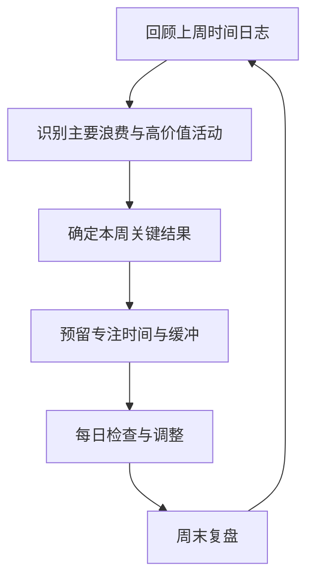

# 时间管理：从记录到有意识地分配注意力

- 番茄工作法
- 时间日志

## 两种常用方法

**番茄工作法**：把一项任务拆成专注工作时段与短暂休息，适合启动困难、容易分心或需要维持节奏的任务。时长可按任务性质调整，不必把固定分钟数当作硬规则。

**时间日志**：记录实际时间花在哪里，用事实识别碎片化、会议负担、频繁切换和低价值活动。

## 每周规划流程

## 实用规则

- 先安排重要但不紧急的工作，再填充零碎任务。
- 给任务写出清晰的下一步动作，降低开始成本。
- 为会议、沟通和突发事件预留缓冲。
- 大任务拆分成可在一个专注时段内推进的步骤。
- 用完成的成果而非忙碌感评估一周。

时间管理的目标是让注意力投向重要事情，并保留恢复、学习和生活的空间。
