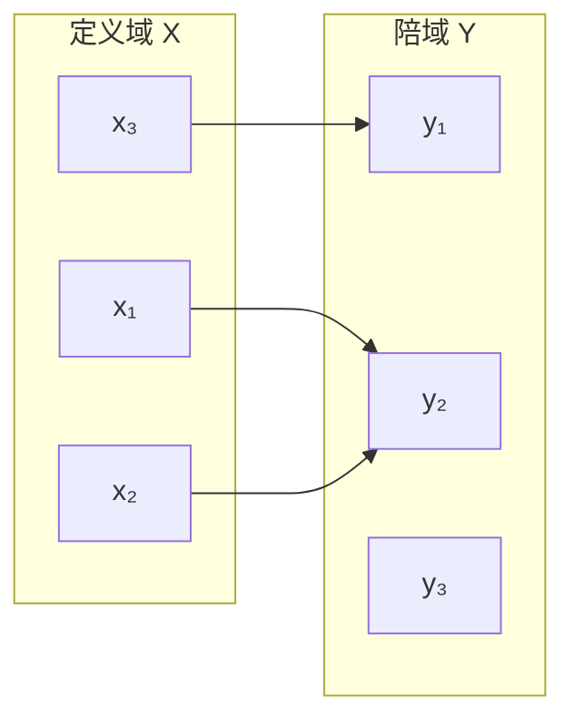

# 映射

> 在数学中，映射描述一个集合中的每个元素如何对应到另一个集合中的唯一元素。这个概念也常用于理解程序中的转换关系、数据模型和系统接口，但不同领域的“映射”需结合上下文定义。

## 1. 数学定义

设 (X) 和 (Y) 是两个非空集合。若存在规则 (f)，使得对每个 (x\in X)，都存在唯一的 (y\in Y) 与之对应，则称 (f) 是从 (X) 到 (Y) 的映射，记作：

[
f:X\rightarrow Y,\quad y=f(x)
]

- (X)：定义域。
- (Y)：陪域（目标集合）。
- (f(x))：元素 (x) 在映射下的像。
- 值域：所有实际出现的像构成的集合，是陪域的子集。

## 2. 映射的直观示意

多个不同的输入可以映射到同一个输出。映射要求每个定义域元素有且只有一个对应输出，但不要求不同输入得到不同输出。

## 3. 常见性质

- **单射**：不同输入对应不同输出。
- **满射**：陪域中的每个元素至少被一个输入映射到。
- **双射**：同时是单射和满射，因此存在反向的一一对应。
- **复合映射**：若 (f:X\to Y)，(g:Y\to Z)，则可定义 (g\circ f:X\to Z)，先执行 (f)，再执行 (g)。
- **逆映射**：只有当映射是双射时，才存在从陪域到定义域的全域逆映射。

## 4. 简单例子

令 (f(x)=2x)，定义域为整数集合 (mathbb Z)，陪域也取 (mathbb Z)。这是一个单射，但不是满射，因为奇数不是任何整数的两倍。

如果将定义域与陪域都取为实数集合，(f(x)=2x) 则是双射，其逆映射为 (f^{-1}(y)=y/2)。

## 5. 与计算机系统的联系

- **类型转换**：把输入值映射到目标类型的值；转换可能有舍入、溢出或信息丢失。
- **地址映射**：将虚拟地址转换为物理地址，过程依赖页表、权限和处理器状态。
- **信号映射**：把网络报文中的信号映射到软件变量或接口。
- **模型映射**：把需求模型、设计模型和实现模型中的元素建立追踪关系。

这些工程用法是类比或具体定义，并不自动继承数学映射的全部性质。

## 6. 常见误区

1. 将陪域和值域混为一谈。
2. 认为映射必须是一对一。
3. 认为任意映射都存在逆映射。
4. 忽略定义域、陪域或输入条件，导致结论不完整。

## 7. 相关笔记

- [[函数]]
- [[数列极限的定义]]
- [[数据结构]]
- [[架构设计]]