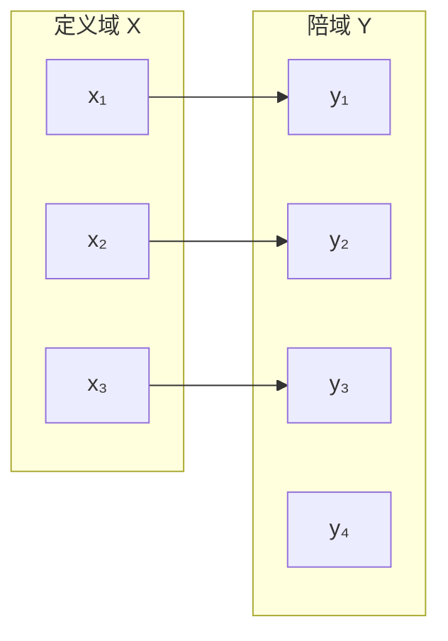

# 映射：集合之间的对应关系

设 (X)、(Y) 是两个非空集合。如果对 (X) 中每个元素 (x)，都有且只有一个 (Y) 中元素 (y) 与之对应，就称这个规则为从 (X) 到 (Y) 的映射，记作

\[
f:X\to Y,\quad y=f(x)
\]

- (X)：定义域（domain）。
- (Y)：陪域（codomain）。
- (f(x))：元素 (x) 在映射下的像。
- 值域：所有实际出现的像组成的集合，是陪域的子集。

## 示例

令 (X=\{1,2,3\})、(Y=\{1,4,9,16\})，定义 (f(x)=x^2)。则值域为 \(\{1,4,9\}\)，陪域仍是给定的 (Y)。

## 常见分类

- **单射**：不同输入对应不同输出。
- **满射**：陪域中的每个元素都至少被一个输入映射到。
- **双射**：既单射又满射，因此存在逆映射。
- **复合映射**：若 (f:X\to Y)，(g:Y\to Z)，则复合映射为 (g\circ f:X\to Z)。

## 关系图

映射要求每个定义域元素恰好有一个像，但允许不同输入映射到同一个输出；陪域中也可以有元素没有被映射到。