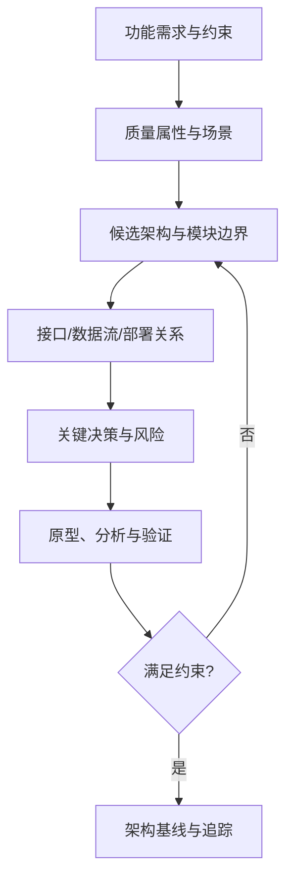

# 架构设计：从需求到可验证的系统结构

软件架构是系统主要结构、构件、接口、交互方式和关键设计约束的抽象。架构不只是模块图，还应解释为什么这样划分，以及方案如何满足质量属性。

## 从需求到架构

## 需要明确的内容

- **职责**：每个构件负责什么，不负责什么？
- **接口**：输入、输出、错误语义、时序和资源约束是什么？
- **依赖**：模块之间的调用、数据流和依赖方向是什么？
- **部署**：软件运行在哪些进程、任务、ECU 或硬件节点上？
- **质量属性**：性能、可靠性、安全性、可测试性和可维护性如何验证？
- **决策记录**：选择方案的原因、替代方案和已知代价是什么？

## 架构评审问题

1. 关键需求能否追踪到模块和测试？
2. 是否存在循环依赖、职责重叠或单点故障？
3. 变更一个接口会影响哪些组件？
4. 异常、超时、资源耗尽和降级路径是否明确？
5. 设计假设是否经过原型或测试验证？

架构图应标明范围与抽象层级。概念图不能代替具体项目的接口定义、时序分析和验证证据。