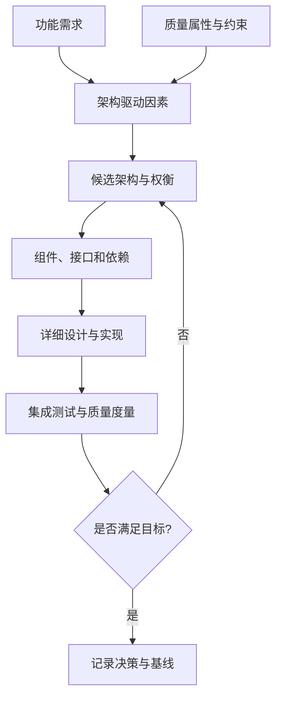
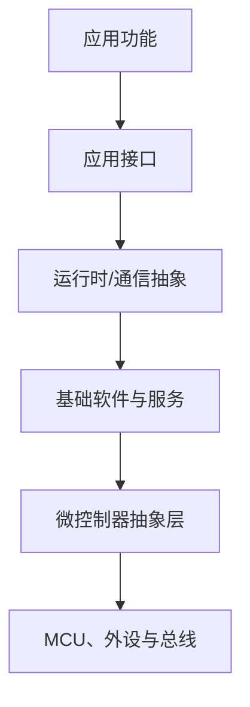

# 架构设计

> 软件架构描述系统由哪些主要构件组成、构件如何交互、依赖关系如何约束，以及这些选择如何满足质量属性。架构不是一张模块图，而是一组能够指导实现、集成、测试和演进的决策。

## 1. 架构要回答的问题

- **职责**：系统拆分成哪些模块？每个模块负责什么、不负责什么？
- **接口**：模块通过什么数据、调用或消息协作？
- **依赖**：哪些模块可以依赖哪些模块？是否存在循环依赖？
- **质量属性**：如何满足实时性、可靠性、安全性、可测试性和可维护性？
- **演进**：需求变化时，哪些模块应当可以独立修改？

## 2. 从需求到架构

架构驱动因素通常包括高风险需求、性能目标、硬件限制、团队能力、外部接口和生命周期成本。

## 3. 常见视角

| 视角 | 关注点 | 典型产物 |
|---|---|---|
| 功能/逻辑视角 | 业务职责如何拆分 | 功能分解图、组件图 |
| 运行/并发视角 | 任务、线程、事件与时序 | 任务映射、时序图 |
| 部署视角 | 软件组件运行在哪些 ECU、进程或硬件上 | 部署图、ECU 分配表 |
| 数据与接口视角 | 数据所有权、格式、方向和更新机制 | 接口定义、数据流图 |
| 质量与安全视角 | 故障隔离、降级、诊断和安全机制 | 安全分析、故障处理策略 |

## 4. 以嵌入式 ECU 为例

该图是简化的分层示意，不是所有嵌入式系统都必须采用的结构。Classic AUTOSAR 的准确层次、模块职责和接口应以相应版本的官方规范为准。

## 5. 架构决策记录（ADR）

每个影响范围较大的设计选择，建议记录：

- **背景**：当时要解决什么问题？
- **决策**：最终选择了什么方案？
- **备选方案**：考虑过哪些其他做法？
- **理由与权衡**：为何选择当前方案？牺牲了什么？
- **影响**：对性能、测试、维护和后续变更有什么影响？
- **验证**：用什么分析、测试或测量确认方案有效？

## 6. 常见反模式

- 只有模块框图，没有接口契约和依赖规则。
- 把“分层”当成目的，层与层之间仍然大量绕过接口。
- 一个模块承担过多职责，修改时引发连锁影响。
- 架构图与实际代码、配置或部署长期不一致。
- 未记录版本、假设和权衡，导致后续团队无法理解决策背景。

## 7. 架构评审清单

- [ ] 每个组件的职责和边界是否清楚？
- [ ] 接口是否定义数据类型、方向、时序和错误行为？
- [ ] 关键质量属性是否有可测量的目标？
- [ ] 关键故障是否有检测、隔离和恢复策略？
- [ ] 架构图是否与代码、配置和部署基线一致？
- [ ] 关键决策是否记录了备选方案和验证依据？

## 8. 相关笔记

- [[软件架构]]
- [[Software Architecture]]
- [[电子电气架构]]
- [[AUTOSAR]]
- [[Runtime Environment]]
- [[Development Process]]
- [[软件工程]]