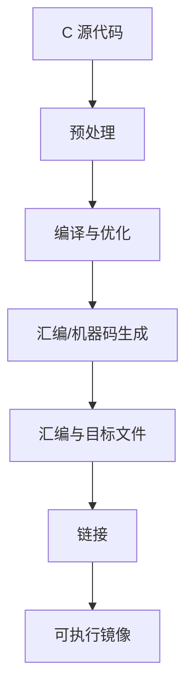

# 汇编语言

> 汇编语言使用助记符表达处理器指令，是理解机器执行、寄存器、内存布局、中断入口和编译器输出的重要工具。汇编语法与指令集相关，学习时必须区分通用概念和具体 CPU 架构。

## 1. 汇编代码如何执行


目标文件还可能包含符号、重定位信息和调试信息。嵌入式固件通常还涉及链接脚本、启动代码、向量表和镜像转换步骤。

## 2. 核心概念

- **指令**：处理器能够执行的操作，例如算术、逻辑、加载/存储、分支和调用。
- **寄存器**：处理器内部的高速状态，包括通用寄存器、程序计数器、栈指针和状态寄存器等。
- **寻址方式**：描述操作数如何定位，例如立即数、寄存器、基址加偏移等。
- **标签与分支**：标签标记位置，分支指令改变程序执行路径。
- **栈与调用约定**：函数调用如何传递参数、保存寄存器、分配局部空间和返回。
- **伪指令/汇编指示符**：指导汇编器组织段、定义常量或符号；它们不一定对应 CPU 指令。

## 3. 读懂一个简单例子

以下是伪汇编示意，语法并非任何特定处理器的可直接编译代码：

```asm
LOAD  R1, [R2]       ; 从 R2 指向的地址读取数据
ADD   R1, R1, #1     ; 将数据加一
STORE [R2], R1       ; 写回内存
```

阅读时要追问：读写的数据宽度是什么？地址是否对齐？该内存是否允许访问？是否有并发访问？真实指令集的操作数顺序和语法可能不同。

## 4. 与 C 语言的关系



编译器优化可能重排、合并或删除源代码中的操作。因此，汇编不一定与 C 语句逐行对应；调试时应结合优化级别、反汇编、符号信息和编译器文档。

## 5. 嵌入式排查的常见切入点

- **复位后没有进入 main**：检查复位向量、启动文件、时钟初始化、内存初始化和链接地址。
- **函数返回异常**：检查栈指针、返回地址、调用约定和栈越界。
- **异常/中断后崩溃**：检查向量表、异常类型、保存现场和返回指令。
- **变量值异常**：确认变量地址、大小端、访问宽度、优化和内存映射。
- **反汇编与源码不一致**：检查编译选项、优化级别、符号文件和当前镜像是否匹配。

这些只是排查方向，具体处理器的异常模型、寄存器语义和启动流程必须查阅对应芯片手册及编译器文档。

## 6. 建议学习顺序

1. 先学习 [[Registers]]、[[Instructions]] 和 [[Memory Management]]。
2. 理解 [[Stack Operations]]、[[Directives]] 与函数调用约定。
3. 对照一段简单 C 程序查看编译器生成的汇编。
4. 学习启动代码、中断入口、链接脚本和异常处理。
5. 在目标芯片与调试器上验证寄存器、栈和内存状态。

## 7. 参考工具

- [Compiler Explorer](https://godbolt.org/)：对比不同编译器、目标架构和优化选项生成的汇编。
- [Globe Engineer 汇编搜索](https://explorer.globe.engineer/?q=%E6%B1%87%E7%BC%96%E7%BC%96%E7%A8%8B)：作为补充检索入口，具体内容需自行核验。

## 8. 相关笔记

- [[C语言]]
- [[Registers]]
- [[Instructions]]
- [[Directives]]
- [[Memory Management]]
- [[Stack Operations]]
- [[Hardware Interrupts]]
- [[Software Interrupts]]