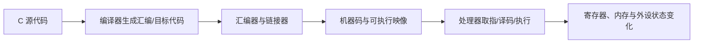

# 汇编语言：理解处理器如何执行程序

汇编语言以助记符和符号表示处理器指令。它与具体指令集架构（ISA）、汇编器语法、调用约定和目标 ABI 密切相关。

## 学习地图

- [[Registers]]：通用寄存器、状态寄存器与特殊寄存器。
- [[Instructions]]：算术、逻辑、访存、分支和调用指令。
- [[Directives]]：指导汇编器组织段、符号与数据。
- [[Memory Management]]：地址、栈、数据布局和访问权限。
- [[Interrupts]]：异常、中断入口与上下文保存。

## 从 C 到机器执行

## 建议的练习顺序

1. 识别寄存器、立即数、地址和内存操作数。
2. 跟踪加减、逻辑运算与条件标志。
3. 理解条件分支、循环、函数调用和返回。
4. 观察栈帧、参数传递和局部变量布局。
5. 对照 C 代码、编译器输出和调试器单步执行。
6. 学习异常、中断与启动流程。

## 阅读代码时注意

- 不同 ISA 的指令和寄存器命名不能混用。
- 调用约定决定参数、返回值和寄存器保存规则。
- 编译器优化会改变指令顺序或消除部分源码结构。
- 访问外设寄存器时必须遵守芯片手册规定的访问宽度和副作用。

外部练习入口：[汇编编程交互练习](https://explorer.globe.engineer/?q=%E6%B1%87%E7%BC%96%E7%BC%96%E7%A8%8B)。实际项目以对应芯片参考手册和工具链文档为准。