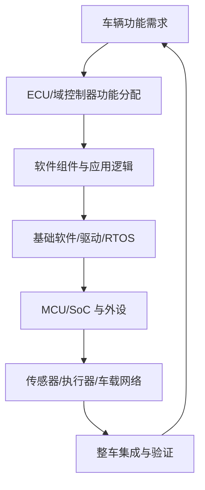

# 汽车电子：从车载 ECU 到整车电子电气系统

汽车电子覆盖车载控制器、传感器、执行器、车载网络、信息娱乐、安全辅助和电动化等系统。理解汽车电子需要同时考虑硬件、电气接口、嵌入式软件、通信协议、诊断、功能安全与系统集成。

## 主要领域

- **车身电子**：门窗、座椅、灯光、雨刮和车身控制模块。
- **动力与底盘**：动力控制、制动、转向、悬架与车辆动态控制。
- **车载网络**：CAN、LIN、汽车以太网、网关与网络管理。
- **信息娱乐与连接**：导航、音响、显示、蓝牙和车载连接。
- **驾驶辅助与自动驾驶**：感知、定位、规划、控制和驾驶员监测。
- **电动化**：电池管理、充电控制、电驱和热管理。
- **诊断与更新**：故障诊断、刷写、数据记录和软件生命周期管理。

## 系统结构示意

## 工程分析的切入点

1. 明确功能、输入输出和故障安全状态。
2. 识别 ECU、接口、报文、周期与时序约束。
3. 检查供电、接地、复位、时钟和物理层条件。
4. 从应用、通信栈、驱动到硬件分层定位问题。
5. 用诊断数据、总线记录、示波器测量和回归测试验证结论。

相关入口：[[电子电气架构]]、[[整车平台]]、[[AUTOSAR]]、[[嵌入式系统]]、[[软件定义汽车]]。