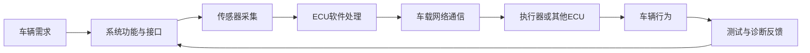
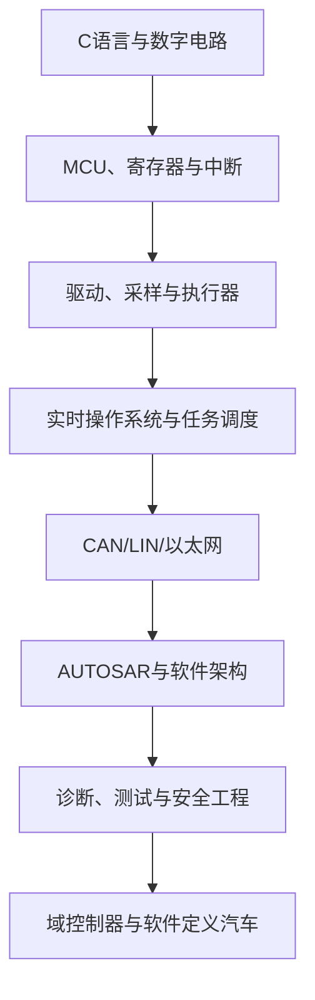

# 汽车电子

> 汽车电子是由传感器、控制器、执行器、车载网络和软件共同构成的系统。理解汽车电子，不应只停留在功能清单，而要同时理解信号如何采集、控制逻辑如何运行、ECU 如何通信，以及系统如何验证安全性与可靠性。

## 1. 汽车电子系统的基本组成

| 组成 | 主要职责 | 典型例子 |
|---|---|---|
| 传感器 | 将物理量转换为可处理的信号 | 轮速、温度、压力、摄像头、雷达 |
| ECU | 运行控制算法、状态机和诊断逻辑 | 车身控制器、动力控制器、域控制器 |
| 执行器 | 将控制命令转化为物理动作 | 电机、继电器、阀门、灯具 |
| 车载网络 | 在 ECU 之间传递信号和服务 | CAN、LIN、车载以太网 |
| 软件平台 | 提供驱动、通信、诊断、调度和应用运行环境 | Classic AUTOSAR、RTOS、基础软件 |
| 工程工具 | 支持配置、标定、仿真、测试和故障定位 | 编译器、调试器、CANoe、Trace32 |

## 2. 从需求到车辆功能

这是一种概念性流程。实际系统中，通信可能双向进行，控制闭环也可能由多个 ECU、传感器和执行器共同组成。

## 3. 常见功能域

- **车身与舒适系统**：门锁、车窗、灯光、座椅、空调等。
- **动力与底盘控制**：动力输出、制动、转向、悬架等。
- **安全与驾驶辅助**：安全气囊、盲区监测、自动紧急制动、自适应巡航等。
- **信息娱乐与连接**：导航、音响、显示屏、蓝牙、蜂窝网络和在线服务。
- **能源与充电**：电池管理、充电控制、热管理和高压安全。
- **车载网络与网关**：跨网络转发、诊断路由、网络管理和安全通信。

功能域是帮助理解的分类，不代表每家车企都采用相同的 ECU 划分。

## 4. 关键工程问题

1. **实时性**：采样、计算、通信和执行是否满足端到端时限？
2. **可靠性**：传感器异常、通信丢帧、任务超时后系统如何进入安全状态？
3. **可诊断性**：故障能否被检测、记录、上报和复现？
4. **可维护性**：软件版本、配置、标定数据和硬件变更能否追溯？
5. **安全与网络安全**：系统是否具备与风险相匹配的安全机制和访问控制？

## 5. 推荐学习路线

## 6. 相关笔记

- [[电子电气架构]]
- [[整车平台]]
- [[软件定义汽车]]
- [[嵌入式]]
- [[嵌入式硬件]]
- [[嵌入式软件]]
- [[AUTOSAR]]
- [[Bus System]]
- [[Development Process]]

## 7. 资料与边界

本页用于建立概念地图。具体车型的 ECU 清单、网络拓扑、信号周期、诊断服务和安全要求必须以对应项目的系统设计、接口规范、标准版本及测试证据为准。