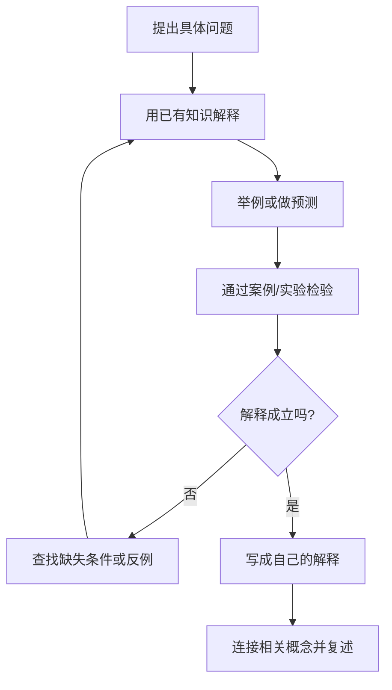

# 理解方法：把信息转化为可解释的模型

理解不等于熟悉术语。真正理解一个概念，通常意味着能够解释它、举出例子、预测结果，并识别适用边界。

## 两种常用方法

### 概念映射

把核心概念与前置知识、组成部分、相邻概念和应用场景连接起来。连线应说明关系含义，例如“依赖于”“导致”“属于”或“与……对比”，而不是只画出没有解释的连线。

### 案例分析

从一个具体案例出发，识别条件、机制、结果和例外，再回到一般原理。案例应包含可核查的事实或可复现步骤。

## 理解闭环

## 自测问题

- 我能否不用原文解释核心机制？
- 我能否给出一个正例和一个反例？
- 哪些前置条件改变时，结论会变化？
- 如何通过实验、计算或来源核查来验证？
- 这个概念能帮助我解决什么实际问题？

遇到复杂主题时，先画出最小模型，再逐步加入例外和细节。