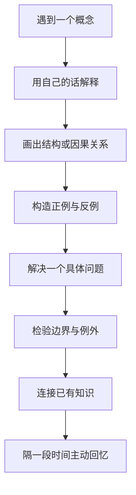

# 理解方法

> 真正的理解不只是能够复述定义，而是能够用自己的话解释机制、举出例子、辨别边界，并把知识迁移到新问题中。

## 1. 从“看懂”到“会用”

## 2. 五种常用方法

### 概念映射

找出概念之间的关系，例如“组成、依赖、因果、对比、先修、应用”。不要只画一张漂亮的图，要能解释每条连线为什么存在。

### 案例分析

从一个具体问题出发，依次说明背景、约束、方案、结果和局限。案例最好包括一个成功例子和一个失败/边界例子。

### 费曼式解释

尝试用初学者能理解的语言讲清楚一个主题。遇到只能重复术语的地方，就回到原理补课。简化表达不意味着删掉关键条件。

### 对比学习

将容易混淆的概念放在同一张表中，比较目标、机制、前提、代价和失败条件。例如栈与堆、轮询与中断、CAN 与 LIN。

### 主动回忆与间隔复习

先遮住答案，自己写出定义、步骤或原因，再核对并修正。复习间隔应根据记忆难度与实际表现调整，而不是只重复阅读。

## 3. 一个可复用的提问模板

学习任意概念时，可以依次问：

1. 它是什么？用一句话定义。
2. 它解决什么问题？没有它会怎样？
3. 它如何工作？关键步骤和因果关系是什么？
4. 它依赖什么前置条件？
5. 哪个例子最能说明它？
6. 哪个反例能说明它的边界？
7. 它与哪些概念相似，又有什么区别？
8. 如何验证自己真的理解了？
9. 在真实项目中会遇到什么故障？
10. 下一步还需要查证什么？

## 4. 用工程问题检验理解

例如学习中断时，不应只记住“中断能及时响应事件”，还应解释中断屏蔽、优先级、现场保存、延迟、重入、共享数据竞争和最坏响应时间，并能通过调试或测量验证。

## 5. 相关笔记

- [[学习方法]]
- [[学习策略]]
- [[卡片笔记]]
- [[知识管理]]
- [[笔记编写规范]]
- [[实践学习]]