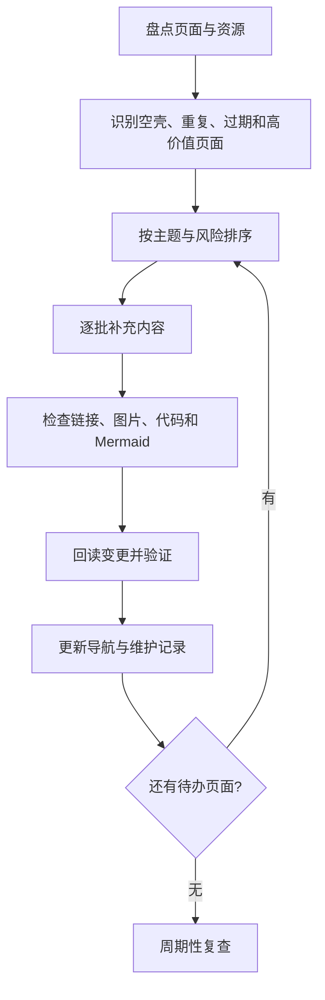

# 知识库全量完善计划

> 本页用于持续治理整个 Notes 知识库。目标是让已有笔记变得可理解、可检索、可验证、可复用；不是为了统一格式而清空旧记录或重写所有内容。

## 1. 完善目标

- **保留原始信息**：不随意删除日记、白板、图片、插件文件或历史记录。
- **先修入口，再修正文**：优先改善主页、专题导航和高频空壳页面。
- **以问题组织内容**：标题表达概念、问题或结论，不仅仅是一个宽泛分类。
- **建立可追溯证据**：技术结论关联标准版本、来源、代码、实验或测试。
- **逐批推进**：每批都有明确范围、差异和验证结果，避免一次性大规模重写造成内容损失。

## 2. 全库治理流程

## 3. 优先级规则

| 优先级 | 页面类型 | 处理方式 |
|---|---|---|
| P0 | 导航失效、关键事实错误、误导性技术说明 | 先修正并保留变更依据 |
| P1 | 核心专题入口、只有一两条链接的空壳页 | 补充定义、结构图、学习顺序和相关链接 |
| P2 | 技术内容已有基础但缺示例/验证 | 补充代码、实验、边界条件和排错流程 |
| P3 | 资源收集、长清单、低频概念页 | 去重、标注来源与适用范围，按需扩写 |
| P4 | 历史日记、白板、原始摘录 | 原则上保留；必要时创建摘要页并链接回原始内容 |

## 4. 单页完成标准

每个知识型页面按适用性检查以下项目，不要求每页机械地全部包含：

- [ ] 标题和首段说明主题、问题或结论。
- [ ] 定义与适用范围清楚，缩写首次出现时有解释。
- [ ] 说明为什么重要，以及它与相邻概念的区别。
- [ ] 有例子、表格、Mermaid 图或步骤图（确实有助于理解时）。
- [ ] 技术页面记录版本、环境、前置条件和限制。
- [ ] 关键结论有来源，或标明为待验证的假设。
- [ ] 工程类页面有诊断思路、异常场景或验证方法。
- [ ] 内部链接名称正确，目标页面存在。
- [ ] 图片路径、代码块和 Mermaid 语法已检查。
- [ ] 与已有笔记建立关联，避免复制粘贴造成多个过期版本。

## 5. 专题推进顺序

### 第一组：核心技术
- AUTOSAR：平台、分层、SWC/RTE、BSW、通信、诊断、存储、配置、版本与工具。
- 嵌入式：C、处理器、内存、中断、驱动、RTOS、通信、调试与测试。
- 编程与计算机基础：C、数据结构、编译原理、操作系统、Git 和软件工程。
- 汽车电子：E/E 架构、网络、ECU、软件定义汽车与系统工程。

### 第二组：知识工作流
- 知识管理、卡片笔记、第二大脑、笔记管理与专题导航。
- 阅读管理、来源管理、复习、输出与知识复用。
- 学习管理、学习策略、工具管理和项目复盘。

### 第三组：数学与其他主题
- 高等数学、函数、导数、极限等基础知识。
- 工业 4.0、数字化营销、项目管理和其他长期积累主题。
- 图片、白板、收藏和外部资源的索引与来源检查。

## 6. 已完成批次记录

### 批次：核心概念页扩写（2026-10-24）

已扩写并回读以下页面：
- [汽车电子](汽车电子.md)：组成、信号链、功能域、工程问题与学习路线。
- [架构设计](架构设计.md)：架构驱动因素、视角、ADR 和评审清单。
- [汇编语言](汇编语言.md)：执行链、核心概念、嵌入式排查和学习路线。
- [编程语言](编程语言.md)：语言类别、通用学习方法与嵌入式路线。
- [理解方法](理解方法.md)：概念映射、案例、对比、主动回忆与问题模板。
- [映射](映射.md)：数学定义、单射/满射/双射、例子和工程类比。
- [整车平台](整车平台.md)：平台、模块化、复用与变型管理。
- [软件定义汽车](软件定义汽车.md)：技术支柱、软件生命周期与工程挑战。
- [软件工程](软件工程.md)：生命周期、验证与确认、质量活动。
- [Logseq 使用指南](LogSeq.md)：页面与块、工作流、备份和排错。
- [知识库导航](知识库导航.md)：更新专题入口和学习路线。

本批次保留原有页面路径，不删除日记、白板、插件或原始资源。已执行 GitHub 文件回读；发布构建与全库链接扫描仍需在后续批次中验证。

### 批次：学习工具与基础方法扩写（2026-10-24）

已扩写并保留原有页面路径：
- [学习环境](学习环境.md)：物理/数字/时间/实践环境与检查清单。
- [笔记软件](笔记软件.md)：保留原有工具入口，补充选型维度与数据迁移检查。
- [SuperMemo 与间隔复习](supermemo.md)：卡片设计、复习闭环和资源核查。
- [函数的求导法则](函数的求导法则.md)：补充常见法则、示例与易错点。
- [Windows 批处理脚本](bat脚本教程.md)：保留既有卡片复习字段和提纲，增加可读的脚本示例与安全提醒。

本批次没有修改卡片页、目录渲染器、白板、日记或插件配置。静态站点构建已由 GitHub Actions 触发，最终结果待运行完成后确认。

## 7. 下一批优先事项

1. 继续扫描知识页面中只有标题、少量链接或单条摘录的页面，优先处理信息、功能和软件等概念页。
2. 检查全库内部链接与发布构建，修正无效目标和渲染异常。
3. 深化 AUTOSAR、C 语言、嵌入式系统与知识管理等高价值专题，补充可验证示例。
4. 对资源清单补充查阅日期、适用版本和失效链接标记。
5. 检查站点构建与发布工作流，记录实际结果，不把未运行的检查标为通过。

## 8. 维护原则

1. 不把未经验证的推测写成事实。
2. 不把特定项目或供应商的实现描述成所有项目通用的标准要求。
3. 不删除原始资料来制造表面整洁；先创建摘要、索引和链接。
4. 不用大量装饰性图表代替解释；图示必须表达实际关系。
5. 不声称完成了全库校验，除非已经逐项检查并记录结果。

## 8. 已执行批次记录（2026-10-24）

- **已完成**：完善嵌入式硬件、嵌入式系统、嵌入式软件、软件架构、架构设计、汇编语言、编程语言、理解方法、卡片笔记、学习环境，以及收藏管理、日记管理、实践学习、视觉学习、在线学习、学习工具、考试管理等页面。
- **新增图示**：`assets/knowledge-workflow.svg`（知识工作流）与 `assets/embedded-architecture.svg`（嵌入式系统分层），并在 README 和导航中引用。
- **保留策略**：不删除原始日记、白板、插件或历史资源；对可能随版本变化的考试、标准与工具信息明确要求回查权威来源。
- **验证范围**：已通过 GitHub 文件接口回读本批变更文件；尚未在实际 Logseq 客户端逐页检查渲染，也尚未确认 GitHub Actions / Pages 部署结果。
- **后续优先级**：继续审阅 AUTOSAR、通信、诊断、NvM、C 语言、操作系统和数学专题中的浅层页面；再批量核对内部链接目标、图片引用和重复主题。不要把本批次描述为“全库已全部完成”。

## 9. 学习工具与学习流程批次（2026-10-24）

- **已完善**：数字化工具、工具软件、传统工具、辅助工具、传统课堂、听觉学习、Area、必学工具、考试管理、软件学习、笔记软件功能和在职研究生计划。
- **改进方向**：增加可执行的选择标准、记录模板、复盘流程与 Mermaid 图，减少只有名词列表的页面。
- **图示复用**：数字化工具页面复用知识工作流 SVG，避免每篇重复绘制同一流程。
- **未完成**：全量内部链接目标检查、所有图片文件引用检查，以及真实 Logseq 渲染和发布流水线验证仍待执行。

## 10. 数学笔记与图示修复批次（2026-10-24）

- 修复数列极限、求导法则页面中错误转义的 Mermaid 围栏，避免图示无法被 Markdown/Logseq 正确识别。
- 新增 `assets/calculus-learning-map.svg`，并嵌入高等数学总览，显示函数、极限、导数、积分和微分方程之间的学习关系。
- 数学内容继续强调定义条件、推导步骤、反例与适用范围；图示用于辅助理解，不能替代严格证明。

## 11. AUTOSAR 工程追踪批次（2026-10-24）

- **已扩写**：[AUTOSAR 学习总入口](AUTOSAR.md)，新增 SWC → RTE → Com → PduR → CanIf → CAN Driver 的端到端信号追踪图。
- **新增核查清单**：补充 SWC Port/Interface、Runnable 触发、Task 映射、生成代码版本一致性等检查项。
- **新增排错表**：针对 RTE API 缺失、应用值不更新、总线信号不变、信号值错误和周期抖动，按证据分层定位。
- **新增验证流程**：配置基线、配置校验、代码生成、完整构建、集成测试、总线测量与回归记录。
- **适用边界**：流程图是通用排查模型，实际模块链路和配置名称应以项目 AUTOSAR 版本、供应商实现与项目基线为准。
- **验证范围**：本次变更已写入独立分支；合并前应回读页面并检查 Mermaid 与代码标记。尚未声称完成全库链接审计或实际目标 ECU 验证。

