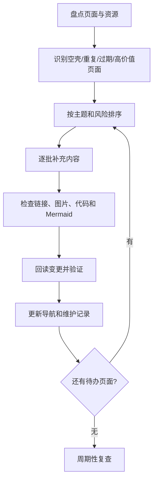

# 知识库全量完善计划

> 本页用于持续治理整个 Notes 知识库。目标是让已有笔记变得可理解、可检索、可验证、可复用；不是为了统一格式而清空旧记录或重写所有内容。

## 1. 完善目标

- **保留原始信息**：不随意删除日记、白板、图片、插件文件或历史记录。
- **先修入口，再修正文**：优先改善主页、专题导航和高频空壳页面。
- **以问题组织内容**：标题表达概念、问题或结论，不仅仅是一个宽泛分类。
- **建立可追溯证据**：技术结论关联标准版本、来源、代码、实验或测试。
- **逐批推进**：每批都有明确范围、差异和验证结果，避免一次性大规模重写造成内容损失。

## 2. 全库治理流程

## 3. 优先级规则

| 优先级 | 页面类型 | 处理方式 |
|---|---|---|
| P0 | 导航失效、关键事实错误、误导性技术说明 | 先修正并保留变更依据 |
| P1 | 核心专题入口、只有一两条链接的空壳页 | 补充定义、结构图、学习顺序和相关链接 |
| P2 | 技术内容已有基础但缺示例/验证 | 补充代码、实验、边界条件和排错流程 |
| P3 | 资源收集、长清单、低频概念页 | 去重、标注来源与适用范围，按需扩写 |
| P4 | 历史日记、白板、原始摘录 | 原则上保留；必要时创建摘要页并链接回原始内容 |

## 4. 单页完成标准

每个知识型页面按适用性检查以下项目，不要求每页机械地全部包含：

- [ ] 标题和首段说明主题、问题或结论。
- [ ] 定义与适用范围清楚，缩写首次出现时有解释。
- [ ] 说明为什么重要，以及它与相邻概念的区别。
- [ ] 有例子、表格、Mermaid 图或步骤图（确实有助于理解时）。
- [ ] 技术页面记录版本、环境、前置条件和限制。
- [ ] 关键结论有来源，或标明为待验证的假设。
- [ ] 工程类页面有诊断思路、异常场景或验证方法。
- [ ] 内部链接名称正确，目标页面存在。
- [ ] 图片路径、代码块和 Mermaid 语法已检查。
- [ ] 与已有笔记建立关联，避免复制粘贴造成多个过期版本。

## 5. 专题推进顺序

### 第一组：核心技术

- AUTOSAR：平台、分层、SWC/RTE、BSW、通信、诊断、存储、配置、版本与工具。
- 嵌入式：C、处理器、内存、中断、驱动、RTOS、通信、调试与测试。
- 编程与计算机基础：C、数据结构、编译原理、操作系统、Git 和软件工程。
- 汽车电子：E/E 架构、网络、ECU、软件定义汽车与系统工程。

### 第二组：知识工作流

- 知识管理、卡片笔记、第二大脑、笔记管理与专题导航。
- 阅读管理、来源管理、复习、输出与知识复用。
- 学习管理、学习策略、工具管理和项目复盘。

### 第三组：数学与其他主题

- 高等数学、函数、导数、极限等基础知识。
- 工业 4.0、数字化营销、项目管理和其他长期积累主题。
- 图片、白板、收藏和外部资源的索引与来源检查。

## 6. 每批变更记录

每次完善一批页面时，记录：

- 批次名称与日期：
- 涉及页面：
- 新增/修正的内容：
- 需要外部核实的事实：
- 已完成的检查：
- 未完成事项：
- 下一批优先页面：

## 7. 维护原则

1. 不把未经验证的推测写成事实。
2. 不把特定项目或供应商的实现描述成所有项目通用的标准要求。
3. 不删除原始资料来制造表面整洁；先创建摘要、索引和链接。
4. 不用大量装饰性图表代替解释；图示必须表达实际关系。
5. 不声称完成了全库校验，除非已经逐项检查并记录结果。
