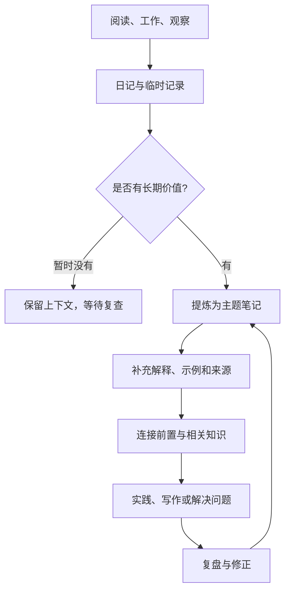
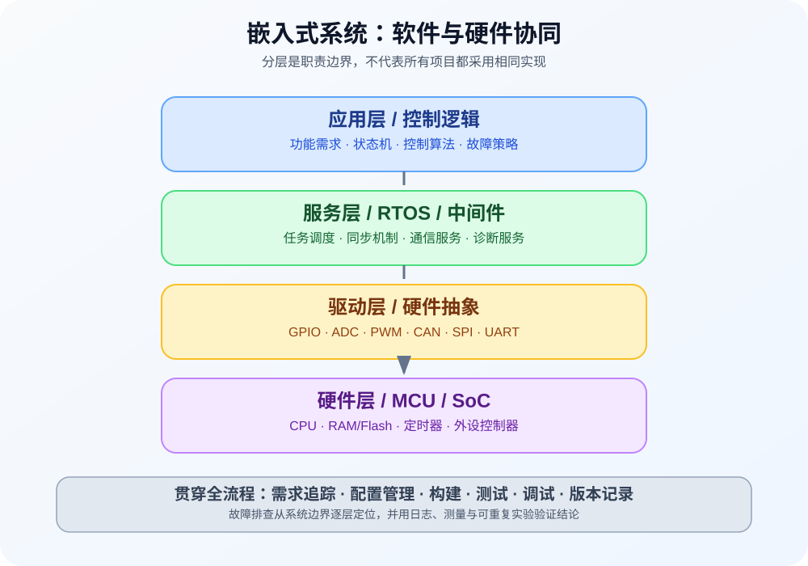
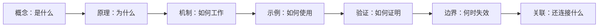

# 知识库导航

> 从问题出发，沿着概念、原理、实践、验证与复盘逐步深入。本页是知识入口，不替代专题正文或原始记录。

## 1. 知识如何流动

## 2. 主题入口

### A. 汽车电子、嵌入式与 AUTOSAR

| 学习阶段 | 关注内容 | 入口 |
|---|---|---|
| 入门 | 嵌入式系统、硬件与软件基础 | [嵌入式](嵌入式.md)、[嵌入式系统](嵌入式系统.md)、[嵌入式硬件](嵌入式硬件.md)、[嵌入式软件](嵌入式软件.md) |
| 基础 | C 语言、寄存器、中断、内存与汇编 | [C 语言](C语言.md)、[寄存器](Registers.md)、[内存管理](Memory%20Management.md)、[堆管理](Heap%20Management.md)、[汇编语言](汇编语言.md) |
| 架构 | 汽车电子、E/E 架构、整车平台 | [汽车电子](汽车电子.md)、[电子电气架构](电子电气架构.md)、[整车平台](整车平台.md)、[架构设计](架构设计.md)、[软件定义汽车](软件定义汽车.md) |
| AUTOSAR | 平台、BSW、通信、诊断与配置 | [AUTOSAR](AUTOSAR.md)、[Classic Platform](Classic%20Platform.md)、[Basic Software](Basic%20Software.md)、[通信栈](Communication%20Stack.md)、[诊断栈](Diagnostic%20Stack.md)、[配置](Configuration.md) |
| 工程实践 | 调试、标准、过程与工具 | [Trace 32](Trace%2032.md)、[标准](Standards.md)、[开发流程](Development%20Process.md)、[工具](Tools.md)、[软件工程](软件工程.md) |

### B. 编程与计算机基础

- [编程语言](编程语言.md)：语言分类、学习顺序与工程能力。
- [C 语言](C语言.md)：语法、类型、内存与程序组织。
- [计算机自学指南](CS自学指南.md)：规划计算机基础知识。
- [数据结构](数据结构.md)：数据组织方式与算法基础。
- [编译原理](编译原理.md)：从源代码到可执行程序的过程。
- [Git](Git.md)：版本管理与协作。
- [Windows 批处理脚本](bat脚本教程.md)：变量、条件、循环和自动化脚本。
- [汇编语言](汇编语言.md)、[指令](Instructions.md)、[寄存器](Registers.md)：从底层理解程序执行。
- [操作系统](OS%28Operating%20System%29.md)：调度、中断、同步与实时性。
- [软件工程](软件工程.md)、[架构设计](架构设计.md)：工程过程、设计决策和质量保障。

### C. 知识管理与学习方法

- [知识管理](知识管理.md)：知识的获取、组织、连接与复用。
- [笔记管理](笔记管理.md)、[笔记编写规范](笔记编写规范.md)：维护笔记并提升可复用性。
- [卡片笔记](卡片笔记.md)：将一个核心观点写成可独立理解的卡片。
- [打造第二大脑](打造第二大脑.md)：建立外部记忆与检索系统。
- [理解方法](理解方法.md)、[学习方法](学习方法.md)、[学习策略](学习策略.md)、[学习管理](学习管理.md)：从理解到执行和复盘。
- [学习环境](学习环境.md)、[传统工具](传统工具.md)、[数字化工具](数字化工具.md)：设计学习场景和工具链。
- [阅读管理](阅读管理.md)、[博客收集](博客收集.md)、[好书推荐](好书推荐.md)：管理输入与阅读成果。
- [Logseq 使用指南](LogSeq.md)：页面、块、双向链接和维护工作流。
- [笔记软件](笔记软件.md)：评估数据导出、离线、同步与长期维护能力。
- [SuperMemo 与间隔复习](supermemo.md)：主动回忆与复习卡片设计。
- [收藏管理](搜藏管理.md)、[常用链接](常用链接.md)、[工具管理](工具管理.md)：管理外部资源与工具。

### D. 数学与基础知识

- [高等数学](高等数学.md)
- [函数](函数.md)
- [映射](映射.md)
- [函数的求导法则](函数的求导法则.md)
- [导数的概念](导数的概念.md)
- [数列极限的定义](数列极限的定义.md)

## 3. 推荐的深入方式

学习一个主题时，建议至少完成：
1. 用自己的话写出定义，而不是只复制资料。
2. 给出一个具体例子；必要时补充代码、公式或图示。
3. 记录一个常见误区、失败场景或边界条件。
4. 链接一个前置知识和一个相关主题。
5. 写下仍未解决的问题，作为后续学习入口。

## 4. 主题成熟度

| 状态 | 判断标准 | 下一步 |
|---|---|---|
| 收集 | 有链接、摘录或待回答的问题 | 确认主题与来源 |
| 理解中 | 能解释核心概念 | 补充自己的解释与例子 |
| 可实践 | 有可复现的步骤、代码或案例 | 验证结果并记录环境 |
| 可复用 | 有边界条件、排错方法与关联链接 | 用于项目、教学或新笔记 |
| 待更新 | 标准、工具或事实可能已变化 | 核查来源和版本 |

成熟度不是知识价值评分，而是提示下一步的维护动作。

## 5. 维护策略

1. 优先修复入口、空壳页和明显错误，再深化核心专题。
2. 新主题应添加到本导航及对应的专题入口。
3. 技术结论尽量记录来源、版本、环境和验证方式。
4. 内部链接、图片路径、代码块和 Mermaid 应在发布前检查。
5. 原始日记、白板、插件和配置应谨慎维护，不为追求格式统一而删除。
6. 对过时内容标注待核查状态，避免静默覆盖历史结论。

图表编写、渲染兼容性与故障排查见 [Mermaid 图表渲染与维护指南](Mermaid图表渲染与维护指南.md)。\n\n完整治理规则见 [知识库全量完善计划](知识库全量完善计划.md)。
