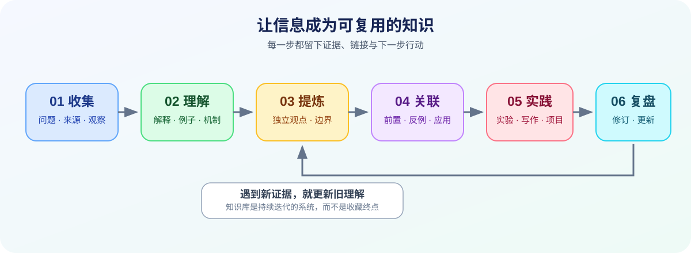
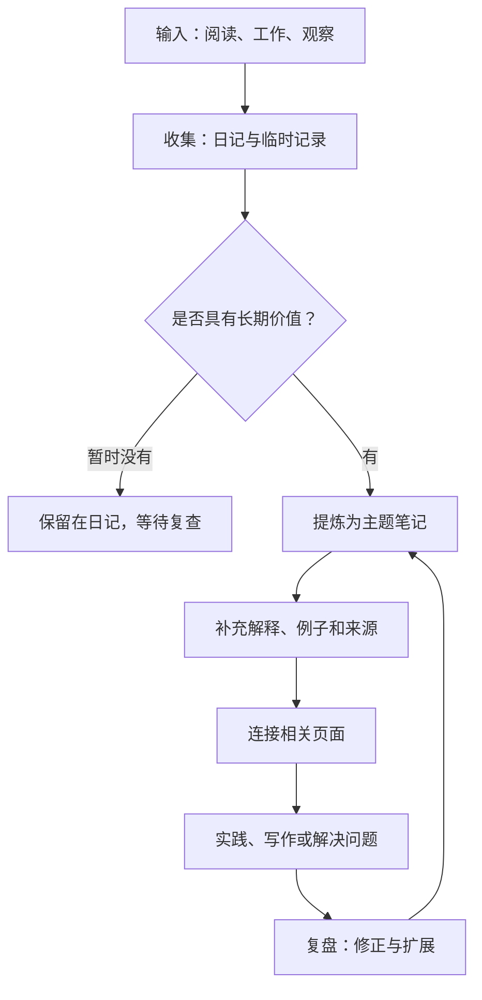

# 知识库导航

> 从问题出发，沿着概念、原理、实践和复盘逐步深入。此页面是主题入口，不替代各专题的原始笔记。

## 1. 知识如何流动

## 2. 主题入口

### A. 汽车电子与嵌入式

| 学习阶段 | 关注内容 | 入口 |
| --- | --- | --- |
| 入门 | 嵌入式系统、硬件与软件基础 | [嵌入式](嵌入式.md)、[嵌入式系统](嵌入式系统.md)、[嵌入式硬件](嵌入式硬件.md)、[嵌入式软件](嵌入式软件.md) |
| 基础 | C 语言、寄存器、中断与内存 | [C 语言](C语言.md)、[寄存器](Registers.md)、[内存管理](Memory%20Management.md)、[堆管理](Heap%20Management.md) |
| 架构 | 汽车电子、E/E 架构、软件架构 | [汽车电子](汽车电子.md)、[电子电气架构](电子电气架构.md)、[架构设计](架构设计.md) |
| AUTOSAR | Classic Platform、BSW、通信与配置 | [AUTOSAR](AUTOSAR.md)、[Classic Platform](Classic%20Platform.md)、[Basic Software](Basic%20Software.md)、[通信栈](Communication%20Stack.md)、[诊断栈](Diagnostic%20Stack.md)、[配置](Configuration.md) |
| 工程实践 | 工具、调试、标准与开发流程 | [Trace 32](Trace%2032.md)、[标准](Standards.md)、[开发流程](Development%20Process.md)、[工具](Tools.md) |

### B. 编程与计算机基础

- [C 语言](C语言.md)：语法、类型、内存与程序组织。
- [计算机自学指南](CS自学指南.md)：规划基础知识的学习顺序。
- [数据结构](数据结构.md)：数据组织方式与算法基础。
- [编译原理](编译原理.md)：从源代码到可执行程序的基本过程。
- [Git](Git.md)：版本管理与协作基础。
- [汇编语言](汇编语言.md)、[指令](Instructions.md)、[寄存器](Registers.md)：底层执行视角。
- [操作系统](OS%28Operating%20System%29.md)：调度、中断、同步和实时性。

### C. 学习方法与知识管理

- [知识管理](知识管理.md)：知识的获取、组织、连接与复用。
- [笔记管理](笔记管理.md)：笔记维护与信息组织。
- [卡片笔记](卡片笔记.md)：将一个核心观点写成可独立理解的卡片。
- [打造第二大脑](打造第二大脑.md)：建立外部记忆与检索系统。
- [学习方法](学习方法.md)、[学习策略](学习策略.md)、[学习管理](学习管理.md)：从方法到执行与复盘。
- [阅读管理](阅读管理.md)、[博客收集](博客收集.md)、[好书推荐](好书推荐.md)：管理输入与阅读成果。
- [笔记编写规范](笔记编写规范.md)：统一专题笔记、实验记录与来源标注。
- [收藏管理](搜藏管理.md)、[常用链接](常用链接.md)、[工具管理](工具管理.md)：维护外部资源与工具。
- [学习工具](学习工具.md)、[实践学习](实践学习.md)、[视觉学习](视觉学习.md)：选择学习方法并验证效果。

### D. 数学与基础知识

- [高等数学](高等数学.md)
- [函数](函数.md)
- [函数的求导法则](函数的求导法则.md)
- [导数的概念](导数的概念.md)
- [数列极限的定义](数列极限的定义.md)

## 3. 推荐的深入方式

每次学习一个主题时，建议至少完成以下动作：

1. 用自己的话写出定义，而不是只复制资料。
2. 写一个具体例子，必要时补充代码、公式或图示。
3. 记录一个常见误区、失败场景或边界条件。
4. 链接一个前置知识和一个相关主题。
5. 写下仍未解决的问题，作为后续学习入口。

## 4. 主题成熟度

| 状态 | 判断标准 | 下一步 |
| --- | --- | --- |
| 收集 | 有链接、摘录或待回答的问题 | 确认主题与来源 |
| 理解中 | 能解释核心概念 | 补充自己的解释与例子 |
| 可实践 | 有可复现的步骤、代码或案例 | 验证结果并记录环境 |
| 可复用 | 有边界条件、排错方法与关联链接 | 用于项目、教学或新笔记 |
| 待更新 | 标准、工具或事实可能已变化 | 核查来源和版本 |

成熟度不是对知识价值的评分，而是提示下一步需要做什么。

## 5. 全库维护策略

本仓库包含专题页、原始记录、白板和 Logseq 配置。整理时应先建立导航与质量规则，再逐批补全内容；不要为追求格式统一而删除有价值的原始记录。

- 第一批：修复只有标题/链接的空壳页面，补充定义、用途、示例、常见错误和相关链接。
- 第二批：深化核心专题，如 AUTOSAR、嵌入式、C 语言、知识管理和计算机基础。
- 第三批：检查内部链接、重复页面、失效外链、版本信息和图片引用。
- 第四批：为需要验证的技术笔记补充实验、代码、测试或可复现步骤。
- 第五批：定期复查标准、工具、软件版本等容易过时的内容。

## 6. 定期维护清单

- [ ] 新增主题已添加到相关索引。
- [ ] 页面标题清晰，正文围绕一个主要问题展开。
- [ ] 关键结论有来源或验证依据。
- [ ] 内部链接指向现有页面，路径中的空格已正确处理。
- [ ] Mermaid 图能表达实际关系，不存在未定义节点造成的歧义。
- [ ] 代码/实验记录包含运行环境、输入条件和预期结果。
- [ ] 过时内容已标注待核查，而不是静默覆盖历史结论。
- [ ] 原始记录、白板、插件和发布流程未被无意改动。
