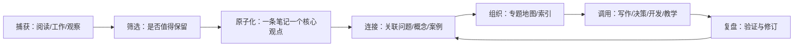

# 知识管理：从收集信息到创造成果

{:height 499, :width 894}

知识管理的目标不是保存尽可能多的资料，而是让信息在需要时可被找到、理解、验证、连接，并最终用于解决问题或创造作品。

## 个人知识系统闭环

## 关键子系统

- [[主页管理]]：把高频入口、当前目标和关键索引放在易找到的位置。
- [[学习管理]]：目标拆解、学习路径、练习、反馈和复盘。
- [[工作管理]]：项目、任务、决策记录和下一步行动。
- [[笔记管理]]：笔记粒度、命名、链接、归档与质量检查。
- [[阅读管理]]：阅读计划、摘录、理解、输出和回顾。
- [[搜藏管理]]：管理网页、论文、视频等外部资料，避免收藏代替学习。
- [[日记管理]]：记录事件、情绪、判断及事后复盘。
- [[考试管理]]：考点地图、错题、间隔复习和模拟测试。

## 建议采用的笔记类型

| 类型 | 主要作用 | 写作重点 |
|---|---|---|
| 收集笔记 | 保存原始来源 | 来源、日期、上下文 |
| 文献笔记 | 记录作者观点 | 用自己的话复述，并标出原文出处 |
| 永久笔记 | 保存可复用的理解 | 单一主张、论据、边界与链接 |
| 项目笔记 | 推进具体工作 | 目标、约束、决策、行动、结果 |
| 实验笔记 | 形成可复现证据 | 环境、步骤、输入、观测、结论 |
| 索引笔记 | 帮助导航 | 问题、子主题、成熟度、下一步 |

## 质量标准

一条有用的笔记应能回答：它在解决什么问题？核心结论是什么？证据在哪里？适用条件是什么？与哪些旧知识有关？未来可以怎样使用？

## 避免常见陷阱

- 不要把所有资料都精加工；先判断是否与当前问题或长期方向有关。
- 不要仅靠标签组织；用有意义的双向链接解释关系。
- 不要把摘录当成自己的理解；写出解释、反例和应用。
- 不要追求一次整理到完美；用小批次维护，优先改善高频入口。
- 不要让知识库成为只进不出的仓库；为每个专题设置输出任务。

## 相关页面

[[卡片笔记]]、[[打造第二大脑]]、[[笔记管理]]、[[阅读管理]]、[[学习管理]]、[[PARA]]、[[LogSeq]]
