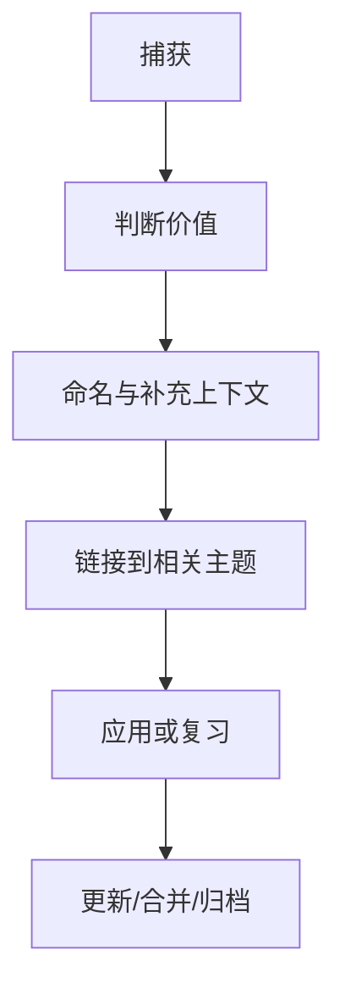

# 笔记管理：结构、链接与维护

{:height 544, :width 797}

- [[功能]]
- [[组织方式]]
- [[应用场景]]
- [[用户体验]]
- [[软件]]
- [[知识库导航]]
- [[笔记编写规范]]

## 笔记生命周期

## 一条笔记应具备的最低信息

- 明确标题，能够表达主题或结论。
- 足够上下文，未来阅读时不依赖当时的记忆。
- 可信来源或清楚标记为个人推断。
- 至少一个有意义的链接，或说明暂时独立的原因。
- 对技术笔记，补充适用版本、环境、输入条件和验证方式。

## 维护节奏

- 每次记录后：修正标题、保留来源、加上必要链接。
- 每周：整理少量高价值笔记，检查待办与重复内容。
- 每月：审查专题索引、失效链接和长期未验证的结论。
- 每个项目结束：保留决策、最终方案、失败经验和可复用模板。

不要为了整齐而频繁重命名所有页面；优先处理入口断链、重复内容和会影响未来使用的错误。
