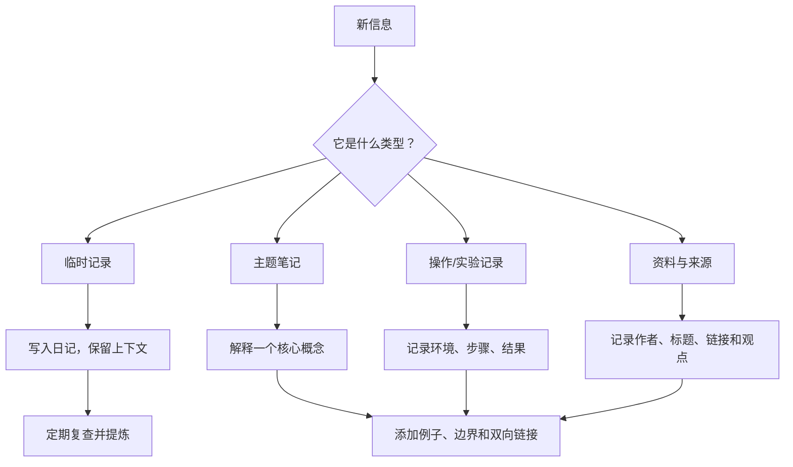
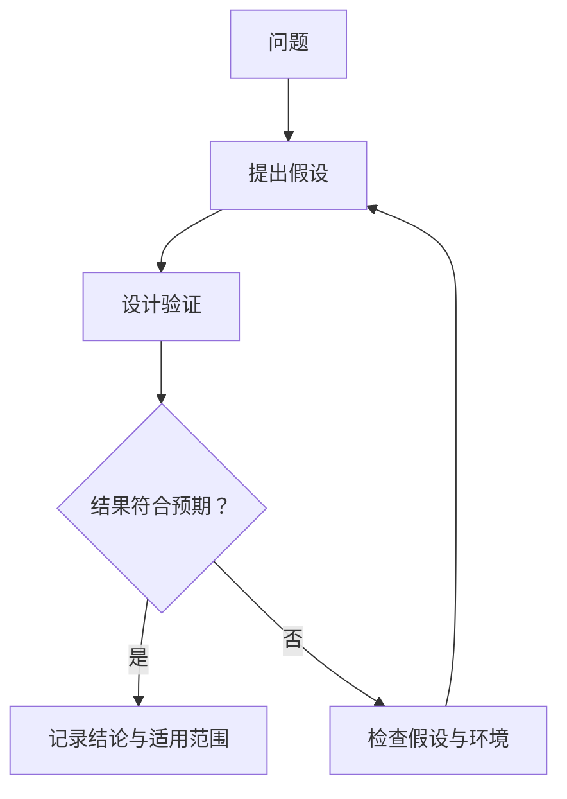

# 笔记编写规范

> 目标不是把资料存得更多，而是让重要知识更容易理解、验证、连接和复用。

## 1. 先判断笔记类型



## 2. 主题笔记模板

新建主题时，可按需要选用以下结构，不必为了填满模板而添加无意义内容。

```markdown
# 主题名称

## 一句话说明
用自己的话概括核心概念。

## 问题背景
它解决什么问题？为什么值得关注？

## 核心原理
解释关键机制、步骤或因果关系。

## 示例与图示
给出一个能帮助读者理解的例子；必要时使用代码、公式或 Mermaid。

## 实践与验证
说明实验环境、操作步骤、预期结果和实际观察。

## 常见误区与边界
在哪些情况下结论不成立？有哪些容易混淆的概念？

## 相关笔记
- 前置知识：
- 相邻主题：
- 延伸问题：

## 参考来源
- 标题、作者/机构、链接、版本或查阅日期
```

## 3. 实践记录模板

```markdown
# 实验名称

- 日期：
- 环境与版本：
- 目标：
- 前置条件：

## 操作步骤
1. ...
2. ...

## 预期结果
...

## 实际结果
...

## 问题与原因
...

## 结论与后续行动
...

## 相关笔记与来源
...
```

## 4. 链接与命名

- 页面标题应描述主题或问题，避免“其他”“杂项”等难以检索的名称。
- 优先复用已有页面，避免同一概念产生多个近似标题。
- 在 Logseq 中使用 `[[页面名称]]` 建立内部链接；在仓库 Markdown 文档中，可使用相对路径链接。
- 链接应有语义：说明两篇笔记之间是前置关系、组成关系、对比关系还是应用关系。
- 重要结论应尽量链接到依据，而不是只留下孤立的结论。

## 5. Mermaid 图示规范

适合用图表达的内容包括：

- 流程：步骤、分支与异常路径。
- 架构：模块、层次和依赖关系。
- 时序：参与者之间的消息与调用顺序。
- 因果：条件、机制和结果之间的关系。
- 学习路线：先修知识与进阶顺序。

示例：



图示应配合文字解释；复杂图优先拆分为多个小图。不要将未经验证的推测画成确定事实。

## 6. 来源与可信度

对技术标准、软件行为、工具选项和可能变化的事实，尽量记录：

- 来源机构或作者；
- 文档标题与稳定链接；
- 适用版本、发布日期或查阅日期；
- 自己验证过的环境与结果；
- 哪些部分是事实，哪些部分是个人推断。

引用外部资料时应提炼并注明出处，避免整段复制而不说明来源。

## 7. 发布前检查

- [ ] 标题准确，正文有明确主题。
- [ ] 核心概念已用自己的话解释。
- [ ] 示例能够理解，必要时已实际验证。
- [ ] 内部链接与图片路径有效。
- [ ] Mermaid 语法与逻辑关系清晰。
- [ ] 变化频繁的内容标明版本或待核查状态。
- [ ] 没有意外包含密码、令牌、个人隐私或不应公开的项目资料。
