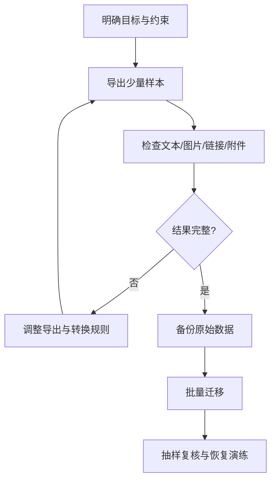

# 笔记软件选择与迁移

本页列出工具作为调研入口，不构成当前版本、价格或功能的排名。产品能力与服务政策可能变化，使用前应查看官方文档。

## 工具入口

| 工具 | 官方网站 | 常见用途/需要核查的点 |
|---|---|---|
| 印象笔记 | [yinxiang.com](https://www.yinxiang.com/) | 笔记与文档管理、导出能力 |
| 有道云笔记 | [note.youdao.com](https://note.youdao.com/) | 云笔记、跨设备同步 |
| 为知笔记 | [wiz.cn](https://www.wiz.cn/zh-cn) | 笔记组织与团队协作 |
| MyBase | [wjjsoft.com](https://www.wjjsoft.com/mybase.html) | 本地知识库与信息归档 |
| Capacities | [capacities.io](https://capacities.io/) | 对象化知识组织 |
| Heptabase | [heptabase.com](https://heptabase.com/) | 白板式视觉思考 |
| Logseq | [logseq.com](https://logseq.com/) | 本地 Markdown、块与双向链接 |
| Obsidian | [obsidian.md](https://obsidian.md/) | 本地 Markdown、插件与链接 |
| Notion | [notion.so](https://www.notion.so/) | 页面、数据库与协作工作区 |
| OneNote | [onenote.com](https://www.onenote.com/) | 自由布局笔记与 Microsoft 生态 |

## 选择标准

- 数据能否完整导出，格式是否开放？
- 是否支持离线使用、全文检索与双向链接？
- 图片、附件、代码块、公式和日期迁移是否完整？
- 同步冲突、误删恢复、版本历史和备份机制如何？
- 是否适合存储个人、工作或敏感资料？
- 长期订阅、插件维护和平台依赖成本如何？

## 迁移流程

迁移前保留原始备份；只有在验证内容、附件和链接后，才考虑切换主存储位置。