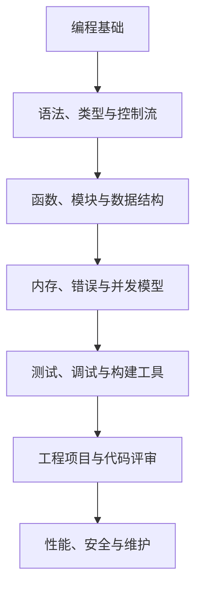
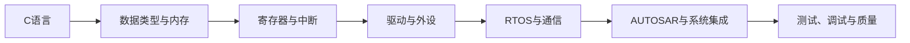

# 编程语言

> 编程语言是表达计算过程的形式系统。学习语言不仅要记忆语法，还要理解类型、内存、执行模型、抽象能力、生态和适用场景。

## 1. 语言学习地图

## 2. 按用途理解语言

| 类别 | 常见用途 | 学习时要关注 |
|---|---|---|
| 系统/嵌入式 | 驱动、固件、运行时、性能敏感代码 | 内存布局、并发、硬件接口、工具链 |
| 通用应用 | Web 服务、桌面应用、业务系统 | 模块化、异常处理、测试、生态 |
| 脚本与自动化 | 构建脚本、数据处理、任务自动化 | 可读性、依赖管理、错误处理 |
| 数据与科学计算 | 数值分析、统计、机器学习 | 数学基础、数组运算、性能与精度 |
| 声明式/查询语言 | 数据查询、配置、规则描述 | 数据模型、约束、可组合性 |

类别之间并非互斥，同一种语言也可能用于多个领域。

## 3. 建议的学习方法

1. 用最小程序验证环境与工具链。
2. 对每个语法点写一个可运行示例，并覆盖正常与异常输入。
3. 通过调试器观察变量、栈、内存和控制流。
4. 将零散知识用于一个小项目，练习目录结构、测试和版本管理。
5. 阅读成熟代码，记录设计理由，而不只是抄写实现。
6. 用复盘说明：解决了什么问题、为何采用此方案、有哪些限制。

## 4. 嵌入式学习路径

## 5. 相关笔记

- [[C语言]]
- [[汇编语言]]
- [[数据结构]]
- [[编译原理]]
- [[OS(Operating System)]]
- [[Git]]
- [[软件工程]]
- [[CS自学指南]]