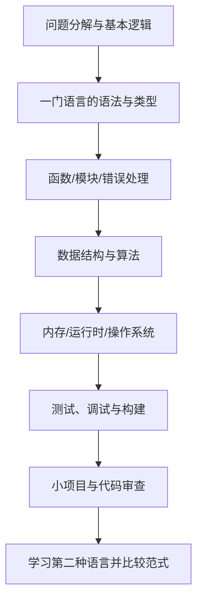

# 编程语言学习地图

编程语言是表达计算过程和组织程序的工具。学习时既要掌握语法，也要理解类型系统、内存模型、运行时、工具链和适用场景。

- [[C语言]]：理解类型、指针、内存布局、编译与底层接口。
- [[汇编语言]]：理解指令集、寄存器、调用约定与处理器行为。
- [[编译原理]]：理解词法、语法、语义、优化与代码生成。
- [[数据结构]]：理解常见数据组织、复杂度与算法。
- [[OS(Operating System)]]：理解进程/线程、调度、同步和资源管理。

## 推荐学习路径

## 每个阶段都应产出

- 可运行的最小示例，而不只是语法摘录。
- 输入、预期输出和边界情况。
- 至少一个常见错误及定位过程。
- 对复杂度、内存、可读性和可维护性的说明。
- 与已有笔记的链接。

不要只比较语言流行度。根据目标任务、运行环境、生态、性能要求和团队维护能力选择工具。