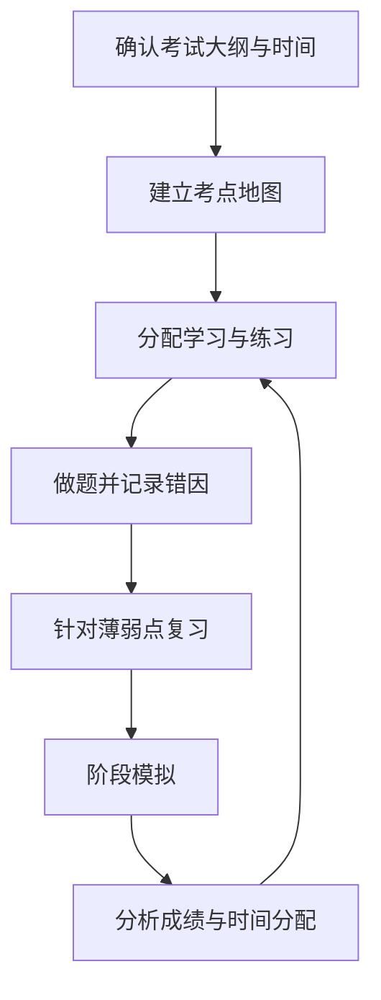

# 考试管理：从考点地图到复习反馈

- [[计算机软高高级]]
- [[在职研究生]]
- [[学习管理]]
- [[记忆技巧]]

## 备考流程

## 错题记录模板

- 题目/考点：
- 错误类型：概念不清、审题错误、计算错误、记忆遗漏、时间不足。
- 正确思路：
- 错误原因：
- 需要补充的知识卡：
- 下次复习日期：
- 变式练习：

复习效果应通过闭卷回忆、变式题和模拟考试验证，不应只依据阅读次数或主观熟悉感。
