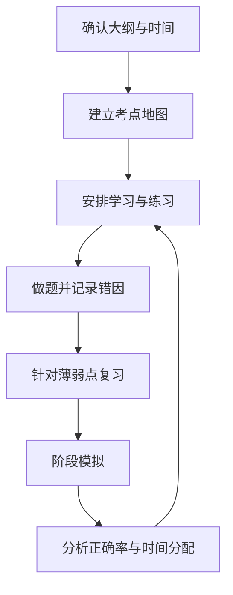

# 考试管理：从考点地图到复习反馈

- [[计算机软高高级]]
- [[在职研究生]]
- [[学习管理]]
- [[记忆技巧]]

## 备考流程

## 错题记录模板

- 题目/考点：
- 错误类型：概念不清、审题错误、计算错误、记忆遗漏、时间不足。
- 正确思路：
- 错误原因：
- 需要补充的知识卡：
- 下次复习日期：
- 变式练习：

## 复习计划的原则

1. 先对照当前官方大纲和考试说明，避免用旧资料代替最新要求。
2. 将考点分成“未学习、学习中、能独立作答、稳定掌握”。
3. 为薄弱点安排主动回忆、间隔复习和变式练习。
4. 模拟考试后分析错因与时间，而不只看总分。
5. 对法规、政策、标准和报名时间等易变信息标记来源与日期。

复习效果应通过闭卷回忆、变式题和限时模拟验证，不应只依据阅读次数或主观熟悉感。