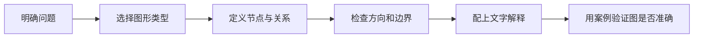

# 视觉学习：用图示表达结构与关系

- 图表与流程图
- 图形化数据
- 概念图、状态机、时序图和架构图

视觉材料的价值在于显示关系、变化和层级，而不只是美化页面。每张图都应回答一个具体问题。

## 常见图示选择

| 想表达的内容 | 推荐形式 |
|---|---|
| 步骤与决策 | 流程图 |
| 时间顺序与交互 | 时序图 |
| 系统层次与模块依赖 | 架构图 |
| 状态与转换条件 | 状态图 |
| 数值变化与比较 | 折线图、柱状图 |
| 概念之间的关系 | 概念图或思维导图 |

## 绘图流程

避免把所有信息塞进一张图。必要时拆分成总览图和细节图，并在图旁说明适用范围与例外。
