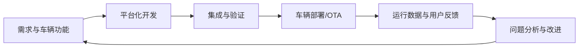

# 软件定义汽车（SDV）

软件定义汽车（Software-Defined Vehicle, SDV）强调通过可升级的软件、可扩展的电子电气架构和持续的数据反馈来演进车辆功能。它不是单一技术，而是涉及车辆架构、软件平台、云端服务、数据治理、安全与组织流程的一组系统性变化。

## 关键组成

- **电子电气架构**：从大量分散 ECU 向域集中、区域控制或混合架构演进。
- **软件平台**：可复用中间件、操作系统、服务接口和应用软件。
- **车辆网络**：支持控制、诊断、数据采集与高带宽通信。
- **OTA 与生命周期管理**：软件包、版本、兼容性、回滚与升级验证。
- **数据闭环**：车辆数据、问题分析、开发验证与功能改进。
- **网络安全与安全工程**：访问控制、威胁分析、故障安全和合规验证。

## 典型闭环

## 需要避免的误解

- SDV 不等于“所有功能都由云端控制”；车辆本地实时控制仍有严格约束。
- OTA 不只是下载文件，还涉及身份认证、完整性、兼容性、失败恢复和安全验证。
- 软件复用不意味着无需车型变体管理、标定和回归测试。
- 数据闭环必须遵守隐私、网络安全和数据治理要求。

研究时建议同时阅读汽车厂商与标准组织的公开资料，并记录发布日期、适用市场和技术边界。入门参考：[Deloitte 关于软件定义汽车的分析](https://www2.deloitte.com/cn/zh/pages/consumer-business/articles/software-defined-cars-industrial-revolution-on-the-arrow.html)。